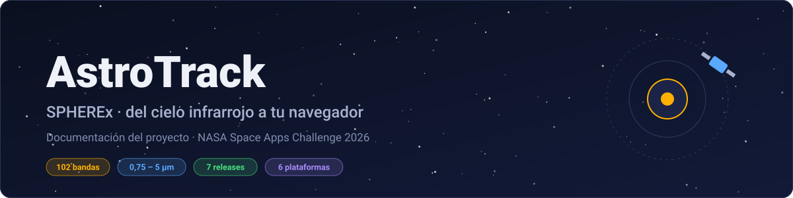

# spherex-releases

Copia pública de los instaladores de **AstroTrack · SPHEREx** ([NASA Space Apps Challenge](https://www.spaceappschallenge.org/) 2026, desafío *Planet X and SPHEREx*).
No contiene código fuente: solo la página de enlaces y los releases.

- Aplicación web (en línea): https://spherex-planet-x-tau.vercel.app/
- Página con los enlaces oficiales: https://vladimiracunadev-create.github.io/spherex-releases/
- Releases anteriores (v0.1.0 a v0.4.1) también están aquí, con sus sumas.
- Release vigente: [v0.4.2](https://github.com/vladimiracunadev-create/spherex-releases/releases/tag/v0.4.2)
- Origen: release `v0.4.1` del repositorio oficial del equipo (etiqueta `v0.4.2`). Los archivos son idénticos; `SHA256SUMS.txt` permite comprobarlo.

Los instaladores no están firmados y no se probaron en equipos reales. Publicado el 2026-11-15.

## 📚 Documentación

Estudio en profundidad del proyecto en [`documentacion/`](documentacion/README.md): [el proyecto](documentacion/01_PROYECTO.md), [arquitectura](documentacion/02_ARQUITECTURA.md), [API](documentacion/03_API.md), [datos de SPHEREx](documentacion/04_DATOS_SPHEREX.md), [backend](documentacion/05_BACKEND.md), [visor](documentacion/06_FRONTEND.md), [apps y releases](documentacion/07_APPS_NATIVAS_Y_RELEASES.md), [hallazgos científicos](documentacion/08_HALLAZGOS_CIENTIFICOS.md), [riesgos y auditoría](documentacion/09_RIESGOS_Y_AUDITORIA.md), [herramientas y uso de IA](documentacion/10_HERRAMIENTAS_Y_IA.md), [glosario](documentacion/11_GLOSARIO.md), [instalar y verificar descargas](documentacion/12_VERIFICAR_DESCARGAS.md) y [cronología](documentacion/13_CRONOLOGIA.md), [preguntas y respuestas](documentacion/14_PREGUNTAS_FRECUENTES.md), [alcance y potencial comercial](documentacion/15_ALCANCE_COMERCIAL.md), [comparativa y estado del arte](documentacion/16_COMPARATIVA_Y_ESTADO_DEL_ARTE.md), [hoja de ruta](documentacion/17_HOJA_DE_RUTA.md), [seguridad y privacidad](documentacion/18_SEGURIDAD_Y_PRIVACIDAD.md) y [el pitch y la entrega](documentacion/19_PITCH_Y_ENTREGA.md) [originalidad y diferenciadores](documentacion/20_ORIGINALIDAD_Y_DIFERENCIADORES.md), [tipos de usuario](documentacion/21_TIPOS_DE_USUARIO.md), [mapa de funciones](documentacion/22_MAPA_DE_FUNCIONES.md), [recorridos y objetivos](documentacion/23_RECORRIDOS_Y_OBJETIVOS.md) y [casos de uso](documentacion/24_CASOS_DE_USO.md). Además, el [CHANGELOG](CHANGELOG.md) y la [política de seguridad](SECURITY.md).

## 🧰 Tecnologías y fuentes de datos

**Lenguajes:** Python 3.11 (backend y análisis), TypeScript y React 18 (visor web), Rust (envoltorio de escritorio con Tauri 2), JavaScript/Node (scripts de empaquetado), Bash y YAML (CI/CD), HTML/CSS.

**Backend y datos:** FastAPI, `pyvo` (consultas SIA2), `astropy` (FITS, WCS, estiramiento de imagen), `numpy`/`scipy`, `pytest` y `ruff`. Caché en disco y respuestas precalculadas para no depender de la red durante la demo.

**Visor:** React + Vite, Aladin Lite 3.8.2 para el cielo, y un explorador propio de imágenes por fecha y banda.

**Apps instalables:** Tauri 2 (Windows, macOS, Linux), Capacitor 6 (APK de Android) y PWA instalable (iPhone/iPad, que no admiten `.ipa` sin cuenta de pago).

**Despliegue y entrega:** Vercel (web `spherex-planet-x`, API `spherex-api` y prototipo, con *rewrites* del mismo dominio para evitar CORS), GitHub Actions (release automático al empujar una etiqueta `vX.Y.Z`), GitHub Releases, GitHub Pages (esta página) y sumas SHA-256 para verificar las descargas.

**Fuentes de datos**
- [NASA/IPAC IRSA](https://irsa.ipac.caltech.edu/): imágenes de nivel 2 de SPHEREx (colecciones `spherex_dr1` y `spherex_qr3`, servicio SIA2) y cubo HiPS del cielo.
- [SIMBAD](https://simbad.cds.unistra.fr/) (CDS, con espejo de Harvard de respaldo) y Gaia para nombres y catálogos de objetos.
- Misión [SPHEREx](https://spherex.caltech.edu/) de la NASA (JPL y Caltech): *This publication makes use of data products from the Spectro-Photometer for the History of the Universe, Epoch of Reionization and Ices Explorer (SPHEREx), which is a joint project of the Jet Propulsion Laboratory and the California Institute of Technology, and is funded by the National Aeronautics and Space Administration.* Datos vía NASA/IPAC IRSA.

## 🤖 Uso de IA y herramientas de trabajo

Usé **Claude Code** (Anthropic) como asistente de programación: para escribir y revisar código de las piezas de entrega, ejecutar pruebas, redactar el análisis de coherencia y publicar los releases. También usé **EGM** (elephant-goldfish-model) como método de revisión de deriva entre documentación y código. Todo lo que aparece en este repositorio lo revisé y lo publiqué yo; la IA no reemplaza la revisión humana. El equipo del proyecto declara el uso de IA en su entrega al hackatón.

## 🙋 Mi participación

Proyecto de equipo (6 personas) del hackatón NASA Space Apps 2026. El repositorio del código es del equipo
([mauriciovalenzuela742/SPHEREX](https://github.com/mauriciovalenzuela742/SPHEREX)); este repositorio solo reúne las descargas. Mi parte:

- **Acceso a datos (rol D1):** consulta a IRSA (SIA2) con caché en disco, el endpoint `/api/epochs`, reintentos ante errores 502 y el precálculo de los 5 campos de la demo para servirlos sin IRSA en vivo.
- **Empaquetado y entrega:** interfaz móvil y PWA instalable ([#43](https://github.com/mauriciovalenzuela742/SPHEREX/pull/43)); instaladores de escritorio con Tauri y APK de Android con Capacitor ([#44](https://github.com/mauriciovalenzuela742/SPHEREX/pull/44)); release automático en GitHub Actions al empujar una etiqueta.
- **Vista «Descargas» de la web** ([#84](https://github.com/mauriciovalenzuela742/SPHEREX/pull/84)): botones por plataforma, detección del dispositivo e instrucciones de instalación.
- **Versión única** ([#86](https://github.com/mauriciovalenzuela742/SPHEREX/pull/86)): la versión del instalador y del APK sale de la etiqueta del release (v0.4.2 es el primero consistente) y el producto pasa a llamarse AstroTrack.
- **Auditoría de coherencia** entre documentación y código ([#71](https://github.com/mauriciovalenzuela742/SPHEREX/pull/71)): 10 hallazgos abiertos como issues [#72 a #81](https://github.com/mauriciovalenzuela742/SPHEREX/issues), con 46 pruebas del backend ejecutadas.
- **Este repositorio:** copia pública de los 7 releases (v0.1.0 a v0.4.2) con sumas SHA-256 y una página que toma la última versión automáticamente.

**Alcance y límites.** El visor, el diseño y el resto del backend son trabajo de otras personas del equipo. Los
instaladores no están firmados y no se probaron en equipos reales. Parte del código de las piezas de entrega y de
la auditoría se escribió con asistencia de IA (Claude Code) y fue revisado y publicado por mí. Esto describe mi
contribución, no un resultado del hackatón.
