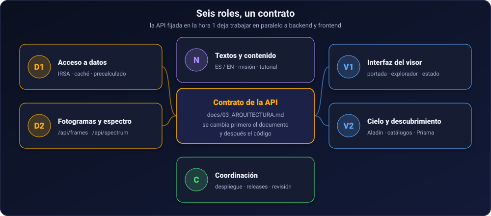

# 🔭 01 · El proyecto

> [!NOTE]
> Resumen del estudio del repositorio oficial del equipo ([mauriciovalenzuela742/SPHEREX](https://github.com/mauriciovalenzuela742/SPHEREX)), hecho el 2026-11-15 sobre `main` en el commit `5b599b9`. Es lectura: no se modificó nada en ese repositorio.

## 💡 En una frase

**AstroTrack** es una herramienta web pública donde cualquiera escribe unas coordenadas del cielo (ascensión recta y declinación) y ve esa zona como un «videíto»: la secuencia de imágenes del telescopio espacial **SPHEREx** de la NASA a lo largo del tiempo. Sirve para detectar a ojo lo que se mueve o cambia de brillo, y además de qué está hecho (las 102 bandas de luz infrarroja).

- **Aplicación en línea:** <https://spherex-planet-x-tau.vercel.app/>
- **Descargas:** [página de enlaces](https://vladimiracunadev-create.github.io/spherex-releases/) · [releases](https://github.com/vladimiracunadev-create/spherex-releases/releases)

## 🎯 El desafío

| Campo | Valor |
|---|---|
| Evento | NASA Space Apps Challenge 2026 (sede Santiago) |
| Desafío | *Planet X and SPHEREx* (dificultad Advanced; astrofísica, planetas y lunas, software) |
| Sitio del evento | <https://www.spaceappschallenge.org/> |
| Qué pide | Una herramienta web pública que muestre imágenes de SPHEREx de un parche de cielo «como un videíto», para ver cómo cambian |
| Cierre de entregas | domingo 15-nov-2026, 11:00 (hora de Santiago) |
| Pitch | 2 minutos + 2 preguntas |
| Uso de IA | Permitido, y su declaración es obligatoria en la entrega |

El desafío nace de cómo se descubrió Plutón (comparando dos imágenes tomadas en fechas distintas) y de proyectos de ciencia ciudadana como Backyard Worlds, donde cientos de miles de voluntarios han hallado cometas y enanas marrones. SPHEREx mapea todo el cielo cada seis meses en 102 bandas de infrarrojo cercano, así que hay más datos de los que una persona (o un programa) puede revisar sola.

## ⚖️ Qué es y qué no es

- **Es un visor.** El que detecta es la persona. Cualquier capa de aprendizaje automático iría encima, nunca en lugar del visor.
- **No es** un detector automático ni un modelo de video.
- **Público objetivo:** cualquiera, no solo astrónomos. La primera pantalla funciona sin saber qué es una ascensión recta.
- **Ángulo propio frente a WiseView:** WiseView ya hace el parpadeo con datos de WISE. Lo que se agrega aquí es el parpadeo **más** el eje espectral: ver no solo que algo se mueve, sino de qué está hecho.

## 🌟 Los cinco objetos de prueba

El enunciado nombra cinco objetos. Sus coordenadas están verificadas contra SIMBAD en `data/campos_de_prueba.yml` del repositorio oficial y funcionan como criterio de aceptación: si la herramienta se comporta bien en los cinco, está terminada.

| Objeto | Tipo | Qué se espera ver | Banda recomendada |
|---|---|---|---|
| WISE 0855−0714 | Enana marrón fría (~2,3 pc), se mueve ~8″/año | Movimiento; débil en una exposición suelta | D5 |
| Estrella de Barnard | Enana roja variable (~1,8 pc), se mueve ~10″/año | Movimiento; **satura** | D2 |
| Epsilon Indi B | Par de enanas marrones (~3,7 pc) | El movimiento más claro de los cinco | D5 |
| RW Aurigae | Estrella variable T Tauri (~65 pc) | Cambio de brillo; **satura** | D3 |
| R Draconis | Variable Mira de período largo (~800 pc) | Curva de luz; está en un campo profundo, con observación casi continua | D4 |

> [!WARNING]
> **Trampa conocida:** la coordenada que el enunciado da para WISE 0855 corresponde a la época de WISE (~2010,4). El objeto se mueve ~8,15″/año y a fines de 2026 está a unos 130″ de ahí; con un campo de 0,05° o menos, queda fuera de la imagen. Por eso el visor usa siempre la **posición propagada**.

## 🏆 Cómo se juzga

El jurado mira impacto, creatividad, validez, relevancia y presentación. El texto del desafío incluye ocho «consideraciones potenciales» que funcionan como rúbrica de diferenciación; el proyecto las cubre así:

| Consideración del desafío | Cómo se aborda |
|---|---|
| Fácil de actualizar con nuevos releases de datos | Consulta SIA2 en vivo a IRSA; no hay datos propios que migrar |
| Mostrar las 102 bandas; espectros al vuelo | Cubo HiPS con deslizador de λ; vista multibanda «Prisma»; endpoint `/api/spectrum` |
| Sumar o restar imágenes de distintas fechas | Modos *resta*, *color*, *apilar visitas* y *Resta A − B* |
| Campo de visión elegible | Tamaños de recorte de 0,05° a 0,5° |
| Overlays de otras misiones | Gaia, CatWISE y SIMBAD sobre el mapa |
| Consultar por coordenadas en la URL | `?ra=…&dec=…&size=…&band=…` (parcial: ver [03_API](03_API.md)) |
| Metadatos como flags de contaminación | `flagged_fraction` por fotograma, con máscara por bits |
| Usar Astropy y Aladin | Astropy en el backend, Aladin Lite 3.8.2 en el visor |

## 👥 Organización del equipo

Seis personas, con roles que separan el trabajo desde la primera hora: **D1** acceso a datos, **D2** fotogramas y espectro, **V1** interfaz del visor, **V2** cielo y descubrimiento, **C** coordinación y despliegue, **N** textos y contenido. El contrato de la API fijado en la hora 1 permite que backend y frontend avancen en paralelo.

## 📚 Documentos siguientes

[02 Arquitectura](02_ARQUITECTURA.md) · [03 API](03_API.md) · [04 Datos de SPHEREx](04_DATOS_SPHEREX.md) · [05 Backend](05_BACKEND.md) · [06 Frontend](06_FRONTEND.md)
