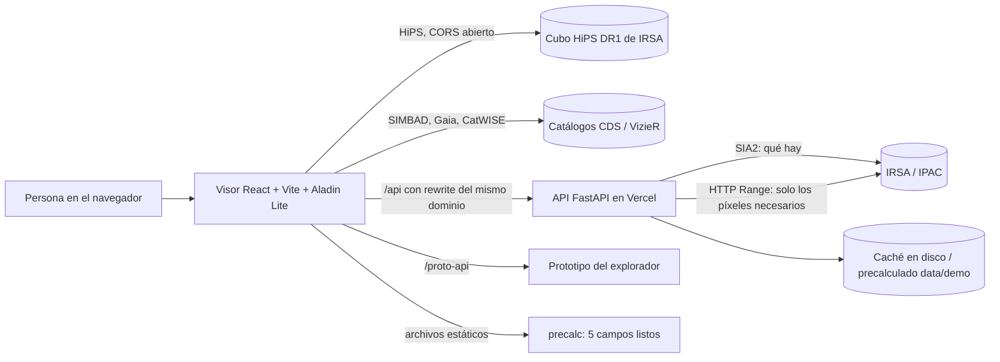

# 02 · Arquitectura

Resumen de `docs/03_ARQUITECTURA.md` y `docs/adr/ADR-001-stack.md` del repositorio oficial, contrastado con el código en `main` (`5b599b9`).

## Dos vías en la misma pantalla

La decisión central es tener **dos caminos independientes**, de modo que si uno falla el otro sigue mostrando algo.

- **Vía A — «el cielo en 102 colores», sin backend.** Aladin Lite carga el cubo HiPS de SPHEREx DR1 que publica IRSA, con un deslizador de longitud de onda y overlays de catálogos. Es el seguro si el backend cae.
- **Vía B — el parpadeo temporal, con backend.** FastAPI consulta SIA2 por posición, pide las imágenes necesarias, las agrupa por banda, resta la luz zodiacal, las alinea (norte arriba), las normaliza y devuelve PNG ordenados en el tiempo.

## Por qué todo pasa por un backend

El estudio de datos (EDA) midió que **IRSA no responde con CORS** (ni SIA2 ni los archivos), salvo el cubo HiPS. El navegador no puede pedirle nada directo, así que SIA2, las cabeceras y los recortes van por el backend. El HiPS sí se carga directo en Aladin.

## Decisiones de diseño y su motivo

| Decisión | Motivo |
|---|---|
| Python 3.11 + FastAPI | `astropy`, `pyvo` y `astroquery` solo existen en Python |
| React + Vite + TypeScript | Rápido de levantar; el equipo lo conoce |
| PNG ya renderizados desde el servidor (no FITS al navegador) | Evita escribir un lector de FITS y el estiramiento en JavaScript; el costo es volver al servidor para cambiar el estiramiento |
| `warnings` como arreglo, no como error | Faltan bandas todo el tiempo; si eso rompiera la petición, la herramienta no funcionaría |
| `wavelength_um` obligatorio por fotograma | Es lo que impide el error de mezclar colores con tiempo (ver [04](04_DATOS_SPHEREX.md)) |
| Lector por rangos HTTP | El servicio de recortes envía ~4 MB por imagen, casi todo PSF; con rangos se piden solo los píxeles necesarios |
| Respuesta parcial con `pending` | Un parpadeo completo «en vivo» (52 s para 25 recortes) no cabe en una espera razonable; se devuelve lo listo y el cliente pide el resto |
| Cinco campos precalculados | La demo no debe esperar a IRSA ni depender del wifi: son también el modo sin conexión |
| Caché en disco | Un recorte tarda 7 s de mediana; sin caché no hay demo (en Vercel no hay disco persistente, ver [09](09_RIESGOS_Y_AUDITORIA.md)) |

## Qué decidieron no hacer

Escrito de antemano para no reabrirlo de madrugada: no escribir un visor de cielo propio (existe Aladin), no implementar shift-and-stack, no entrenar un modelo de video, no hacer fotometría de calidad científica (para eso existe la herramienta de IRSA), no montar cuentas de usuario (un hallazgo se guarda como URL) y no reprocesar nivel 1.

## Despliegue

| Proyecto en Vercel | Qué es | Cómo se actualiza |
|---|---|---|
| `spherex-planet-x` | El visor (`scaffold/frontend`) | Solo, en cada merge a `main` |
| `spherex-api` | Backend oficial (`scaffold/backend`) | A mano: `bash deploy/desplegar.sh api` |
| `spherex-prototipo-d2` | Prototipo del explorador (`prototipos/rango_fechas`) | A mano: `bash deploy/desplegar.sh prototipo` |

El visor llama a los otros dos por *rewrites* del mismo dominio definidos en `vercel.json` (`/api/*` y `/proto-api/*`), sin CORS. El plan gratuito (Hobby) permite 100 despliegues por día para todo el equipo; el 14-nov se agotaron, y desde entonces solo `main` se despliega.

## Plan B documentado

Si las funciones de Vercel no alcanzan en tiempo o memoria, el mismo FastAPI puede correr en un contenedor (Render o Fly) detrás de `/api`, con un *rewrite*. Cambiar de lugar no cambia el contrato.
