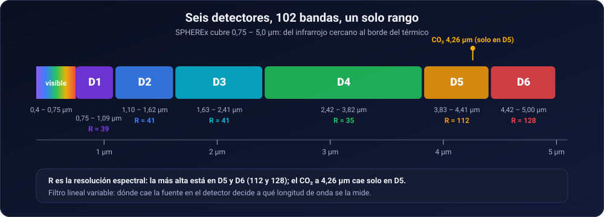
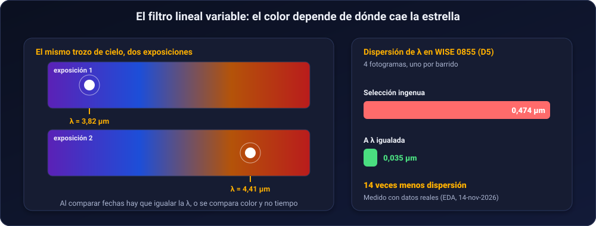

# 🛰️ 04 · Los datos de SPHEREx y cómo se piden

Resumen de `docs/02_DATOS_SPHEREX.md` y `docs/09_EDA_HALLAZGOS.md` del repositorio oficial. Cada cifra sale del estudio exploratorio (`eda/`), que se puede volver a correr.

## 🚀 La misión

SPHEREx (*Spectro-Photometer for the History of the Universe, Epoch of Reionization and Ices Explorer*) es un telescopio espacial de la NASA, proyecto conjunto del JPL y Caltech, que desde mayo de 2025 mapea todo el cielo **cada ~6 meses en 102 bandas de infrarrojo cercano** (0,75–5 µm), con seis detectores (D1–D6). Es sensible a objetos ricos en hidrógeno, agua, CO₂ y CO.

## 🎚️ El detalle que decide el proyecto: el filtro lineal variable (LVF)

SPHEREx no usa filtros de banda: la **longitud de onda cambia de forma continua a lo largo de un eje del detector**. Dónde cae una fuente en la imagen determina en qué longitud de onda se la mide.

> [!IMPORTANT]
> **Consecuencia práctica:** dos imágenes de la misma zona pueden no ser comparables si se tomaron a longitudes de onda distintas. Un parpadeo que no lo tenga en cuenta muestra **color, no tiempo**.

Medido (EDA, datos reales):

- Dentro de un mismo detector, la longitud de onda del objeto recorre ~16 anchos de banda entre archivos.
- Cada longitud de onda se repite cada ~6 meses (cada barrido).
- Igualar la longitud de onda es fácil: hay decenas de pares de épocas con la misma λ. Con selección «a λ igualada», la dispersión baja de **0,47 µm a 0,005–0,04 µm**.
- La λ se calcula **sin bajar el archivo**: la tabla `WCS-WAVE` es fija por detector y la cabecera se pide por HTTP Range (~35 KB).

## 📖 Vocabulario de observación

| Término | Qué es |
|---|---|
| **Apuntado** | Una posición del telescopio. Cada apuntado da 2 archivos, en pares D1+D4, D2+D5, D3+D6 |
| **Visita** | Un paso de SPHEREx por la zona (varias exposiciones en pocos días) |
| **Barrido** | Una pasada completa del cielo (1–6 semanas); vuelve cada ~6 meses |
| **Época** | Una observación en un instante. Un barrido **no** es una época |
| **Nivel 2** | Imágenes ya calibradas y publicadas (de donde parte el proyecto) |

## 🗂️ Versiones de datos y colecciones

Se consultan **DR1 y QR3** (`spherex_dr1`, `spherex_qr3`): no repiten archivos, y QR3 trae el barrido más reciente (salvo WISE 0855, que aún no lo tiene). QR2 ya no es buscable por SIA2. Existen también colecciones `_deep` (campos profundos, como el de R Draconis), que la consulta por defecto no incluye.

## 🔑 Cómo se accede

| Vía | Para qué | Notas |
|---|---|---|
| **SIA2** (IVOA) | Buscar qué hay para una posición | 1–3,5 s por colección; `https://irsa.ipac.caltech.edu/SIA` |
| **HTTP Range** | Cabeceras y solo los píxeles necesarios | ~35 KB; ~0,1 s efectivo con 6 en paralelo |
| **Servicio de recortes (cutouts)** | Recorte FITS listo | Mediana 7,3 s, p90 10,8 s, máximo 29 s, ~3,9 MB sin importar el tamaño (la PSF viene entera) |
| **Cubo HiPS de DR1** | El cielo completo en 102 planos para Aladin | PNG, orden 5, píxel 12,9″, CORS abierto; mosaico sin eje de tiempo (planos 50 y 51 vacíos) |

Otros hechos medidos: IRSA **no** da CORS fuera del HiPS; el cubo DR1 por SIA2 son FITS de ~320 MB por tesela que el servicio de recortes rechaza; con más de 4 recortes en paralelo aparecen 503.

## 📦 Qué hay dentro de un archivo (MEF)

Un MEF de SPHEREx pesa ~70 MB y tiene varias extensiones: `IMAGE` (la imagen), `FLAGS` (máscara de calidad), `VARIANCE`, `ZODI` (luz zodiacal a restar), `PSF` y la tabla `WCS-WAVE`. Por eso los FITS nunca se versionan en el repositorio: van a `data/cache/`, que está en `.gitignore`.

## 🚩 La máscara de calidad (`FLAGS`)

> [!WARNING]
> Una trampa medida: **contar `FLAGS != 0` marca el 72 % del recorte**, porque el bit `SOURCE` (72,4 %) solo indica que hay una fuente conocida, no un error. Hay que usar una máscara por bits; con ella se enmascara ~4 % de los píxeles.

Los nombres de los bits vienen en el propio header.

| Bit | Nombre | % de píxeles | ¿Invalida el píxel? |
|---|---|---|---|
| 21 | SOURCE | 72,4 % | No |
| 28 | HALO | 2,1 % | Discutible |
| 0 | TRANSIENT | 1,6 % | Sí |
| 2 | SUR_ERROR | 1,3 % | Sí |
| 26 | BLOOM | 0,8 % | Discutible |
| 19 | OUTLIER | 0,7 % | Sí |

## 📐 Geometría

La orientación del detector **gira ~180° entre barridos**. Antes de parpadear o restar hay que reproyectar cada recorte a una rejilla común (TAN, norte arriba, escala nativa de 6,15″/px, con `reproject`). Sin eso, la resta compara trozos de cielo distintos.

## 📜 Atribución obligatoria

> This publication makes use of data products from the Spectro-Photometer for the History of the Universe, Epoch of Reionization and Ices Explorer (SPHEREx), which is a joint project of the Jet Propulsion Laboratory and the California Institute of Technology, and is funded by the National Aeronautics and Space Administration.

Datos vía NASA/IPAC Infrared Science Archive (IRSA): <https://irsa.ipac.caltech.edu/Missions/spherex.html>. Tutoriales oficiales: <https://caltech-ipac.github.io/irsa-tutorials/spherex/>.

## 🌐 Otras fuentes

| Fuente | Uso |
|---|---|
| **SIMBAD** (CDS, con espejo de Harvard de respaldo) | Nombres, tipos y movimiento propio de los objetos |
| **Gaia DR3** | Overlay de estrellas (WISE 0855 no está en Gaia) |
| **CatWISE2020** | Overlay para WISE 0855 y candidatos que se mueven |
| **2MASS / AllWISE** | Épocas históricas para comparar contra SPHEREx (1997–2010) |

Ver el glosario completo en [11_GLOSARIO](11_GLOSARIO.md).
