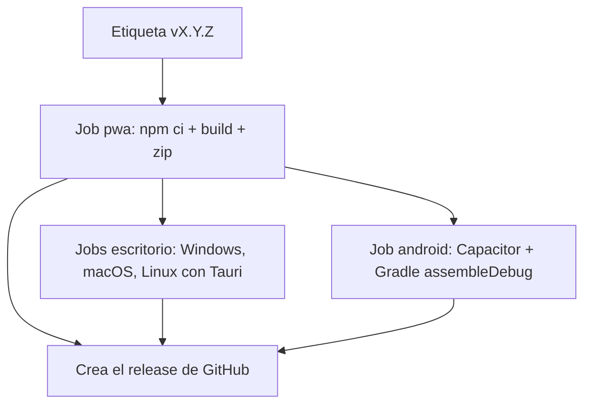

# 07 · Apps instalables y cómo se publican los releases

## Qué es cada app

Son **envoltorios mínimos del visor web**: abren el sitio publicado (<https://spherex-planet-x-tau.vercel.app>) en una ventana nativa. Por eso usan los mismos `/api` y `/proto-api` por *rewrites* (sin CORS), siempre muestran la versión desplegada y **necesitan internet** (la aplicación lo necesita igual para traer los datos).

| Plataforma | Herramienta | Carpeta (repo oficial) | Archivo del release |
|---|---|---|---|
| Windows | Tauri 2 | `native/tauri/` | `AstroTrack-windows-…-setup.exe` y `.msi` |
| macOS (Intel y Apple Silicon) | Tauri 2 | `native/tauri/` | `AstroTrack-macos-…universal.dmg` |
| Linux | Tauri 2 | `native/tauri/` | `.AppImage` y `.deb` |
| Android | Capacitor 6 | `native/android/` | `AstroTrack-android-vX.Y.Z.apk` |
| Web | PWA | `scaffold/frontend/` | `spherex-pwa-vX.Y.Z.zip` |
| iPhone / iPad | PWA | — | Safari → Compartir → «Añadir a pantalla de inicio» |

Si la conexión falla, cada envoltorio muestra una página mínima sin conexión («AstroTrack necesita conexión a internet para mostrar el cielo»).

### Por qué no hay app nativa para iPhone

Apple solo deja instalar apps nativas firmadas con una cuenta **Apple Developer de pago (99 USD/año)**, distribuidas por TestFlight o App Store. El equipo no tiene esa cuenta, así que no hay `.ipa`. Instalar archivos sueltos o con un Apple ID gratuito no es viable (la app caduca a los 7 días y exige un Mac con Xcode). La alternativa gratuita es la PWA. Si algún día hay cuenta, se podría añadir un proyecto iOS con Capacitor; la App Store podría rechazarlo por ser una web envuelta (regla 4.2).

## Cómo se construye un release

Todo ocurre en GitHub Actions (`.github/workflows/release.yml`) **al empujar una etiqueta `vX.Y.Z`**. Para probar sin publicar existe `workflow_dispatch`, que deja los archivos como artefactos del run.

La construcción completa tarda unos 11 minutos. Cada job adjunta sus archivos al mismo release.

## Una sola versión, desde la etiqueta

Antes del release v0.4.2 convivían cinco números: la etiqueta decía 0.4.1, los instaladores de escritorio 0.2.0, el APK 1.0 por dentro, y el frontend y el backend 0.0.1. Desde v0.4.2, **la etiqueta es la única fuente**:

- `native/estampar_version.mjs X.Y.Z tauri` escribe la versión en `tauri.conf.json` y `Cargo.toml` antes de construir el escritorio.
- `native/estampar_version.mjs X.Y.Z android` fija `versionName` y `versionCode` del proyecto Android (`versionCode = mayor·10000 + menor·100 + parche`; 0.4.2 → 402).
- El script falla en voz alta si no encuentra el campo que debía reemplazar.

Comprobado el 2026-11-15 abriendo los archivos de v0.4.2: el APK trae `versionName` 0.4.2 y `versionCode` 402; el `.exe` y el `.msi` 0.4.2 con producto «AstroTrack»; el `.deb` 0.4.2. El `.dmg` y el `.AppImage` solo se comprobaron por el nombre del archivo.

**Los releases v0.1.0 a v0.4.1 siguen con 0.2.0 por dentro en escritorio y 1.0 en el APK.** Cambiarlos exigiría reconstruirlos y mover sus etiquetas.

## Sin firmar

| Plataforma | Qué pasa la primera vez |
|---|---|
| Windows | SmartScreen avisa «Windows protegió su PC» → *Más información* → *Ejecutar de todos modos* |
| macOS | Gatekeeper lo bloquea → clic derecho sobre la app → *Abrir* |
| Android | APK firmado con la clave de depuración; hay que permitir «instalar apps desconocidas» |
| Linux | AppImage: darle permiso de ejecución; `.deb`: instalar con el gestor de paquetes |

Para firmar de verdad harían falta un certificado de código (Windows), Developer ID con notarización (macOS) y un keystore propio (Android), guardados como secretos del repositorio. No se incluyen. **Los instaladores no se han probado en equipos reales**; se construyen y adjuntan en CI.

## Este repositorio

`vladimiracunadev-create/spherex-releases` guarda una **copia pública** de los siete releases (v0.1.0 a v0.4.2), con las sumas SHA-256 de cada uno y una [página](https://vladimiracunadev-create.github.io/spherex-releases/) que toma el último release automáticamente. Las etiquetas apuntan a este repositorio, que no contiene código fuente. Para comprobar una descarga, ver [12_VERIFICAR_DESCARGAS](12_VERIFICAR_DESCARGAS.md). La historia de versiones está en [13_CRONOLOGIA](13_CRONOLOGIA.md).

## Cómo publicar un release nuevo (resumen)

1. Mezclar los cambios en `main` del repositorio oficial.
2. Etiquetar: `git tag -a vX.Y.Z <commit> -m "AstroTrack vX.Y.Z"` y `git push origin vX.Y.Z`.
3. Esperar al CI y abrir los archivos para comprobar la versión por dentro.
4. Copiar el release a este repositorio: descargar los archivos, calcular `sha256sum`, y `gh release create` con las notas.
5. La página de este repositorio se actualiza sola; si cambia el README o el About, hacerlo a mano (el About lleva la versión y el conteo de releases).
