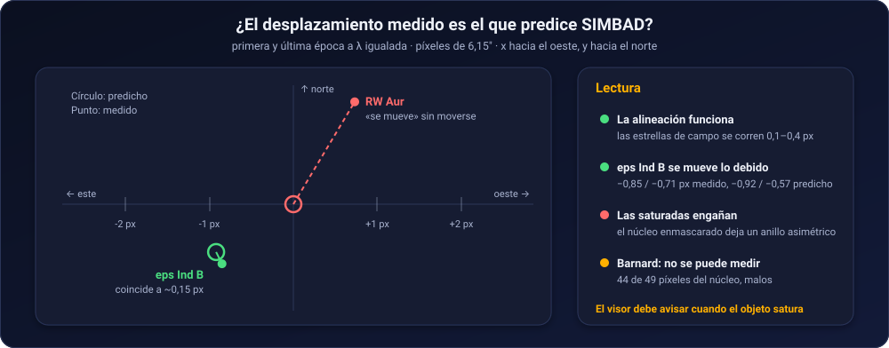

# 🔬 08 · Qué dicen los datos: hallazgos científicos

Resumen de `docs/09_EDA_HALLAZGOS.md` y `docs/hallazgos/` del repositorio oficial. Todo salió de imágenes reales de SPHEREx nivel 2 (NASA/IPAC IRSA). Los números vienen de scripts reproducibles en `eda/`. Lo que no se comprobó está al final.

## 🔟 Diez conclusiones del estudio exploratorio (14-nov-2026)

1. **Datos hay de sobra:** entre 258 y 2.514 archivos por campo, 3–4 barridos, 1,0 a 1,4 años de base temporal.
2. **El movimiento es de 1–2 píxeles en todo el período**, no un salto (píxel de 6,15″; PSF de 7,5–8,7″). Barnard 1,8 px, WISE 0855 1,3 px, eps Ind B 1,1 px.
3. **El movimiento se mide en estrellas que no saturan:** en eps Ind B el centroide se desplaza −0,85 / −0,71 px (oeste / norte) y SIMBAD predice −0,92 / −0,57 px. Las estrellas brillantes (Barnard, RW Aur) **saturan**.
4. **La λ cambia en todo el detector** entre archivos (~16 anchos de banda): un parpadeo ingenuo mezcla 16 «colores».
5. **Igualar la λ es fácil** (decenas de pares de épocas con la misma λ).
6. **La λ se calcula sin bajar el archivo** (HTTP Range, ~35 KB; ~1.900 archivos en ~2,5 minutos).
7. **La orientación gira ~180° entre barridos:** hay que reproyectar a una rejilla común.
8. **Un recorte tarda 7 s de mediana (p90 11 s, máximo 29 s) y pesa ~3,9 MB:** sin caché no hay demo.
9. **IRSA no responde con CORS:** todo pasa por el backend.
10. **El cubo DR1 tiene dos versiones:** la de SIA2 (FITS de ~320 MB, no sirve) y la **HiPS**, que sí carga en Aladin.

## 📊 Cuántos archivos hay por campo

| Campo | DR1 | QR3 | Barridos | Base temporal |
|---|---|---|---|---|
| WISE 0855 | 258 | 0 | 3 | 1,02 años |
| Barnard | 240 | 124 | 3 | 1,10 años |
| eps Ind B | 347 | 120 | 4 | 1,44 años |
| RW Aur | 226 | 110 | 3 | 1,04 años |
| R Dra | 422 (+1.233 deep) | 126 (+733 deep) | continuo | 1,42 años |

R Draconis está cerca del polo norte de la eclíptica, con observación casi continua: es el campo para probar curvas de luz, no el típico.

## 🎯 ¿El movimiento medido es el que predice SIMBAD?

| Campo | Medido (px) | Predicho (px) | Núcleo enmascarado |
|---|---|---|---|
| eps Ind B | −0,85 / −0,71 | −0,92 / −0,57 | 1 y 0 de 49 píxeles |
| RW Aur | +0,73 / +1,22 | 0 / 0 | 6 y 8 de 49 |
| Barnard | no se puede medir | +0,14 / +1,81 | 44 y 44 de 49 |

**La alineación funciona** (las estrellas de campo se desplazan una o dos décimas de píxel) y **eps Ind B se mueve lo que tiene que moverse**, dentro de ~0,15 px en cada eje.

> [!WARNING]
> **Las estrellas que saturan engañan:** RW Aur «se mueve» 1,4 px sin moverse, porque el núcleo viene enmascarado y queda un anillo asimétrico. En la resta aparece el mismo par rojo/azul que deja un objeto que sí se mueve. **El visor tiene que avisar cuando el objeto satura.**

## ❄️ WISE 0855: cómo se ve su movimiento

Es caso obligatorio del desafío. **Sí se ve en SPHEREx, pero solo con la configuración correcta:** banda D5, **10 exposiciones combinadas por visita**, primera visita (6-may-2025) contra la última (13-may-2026). La resta muestra una pareja limpia: azul al este (donde estaba) y rojo al oeste (donde está), separados ~1 píxel. Con una sola exposición por visita no se ve: la mancha roja probablemente es el cambio de longitud de onda, no movimiento.

Comparación del número de exposiciones por visita (banda D5, primera contra última):

| Objeto | Esperado | `per_visit = 1` | `per_visit = 10` |
|---|---|---|---|
| eps Ind B | 0,93 px E · 0,57 px S | 1,70 px O · 3,27 px S (ruido) | 0,79 px E · 0,74 px S ✓ |
| WISE 0855 | 1,33 px O · 0,11 px N | 0,01 px O · 0,69 px S (no se ve) | 0,95 px O · 0,25 px N ✓ |

Por eso el visor abre WISE 0855 y eps Ind B con la mediana de 10 exposiciones y datos precalculados.

## 🧬 Huella espectral y limpieza de fondo

Análisis posterior (`eda/huella_espectral/`, `docs/hallazgos/huella_espectral_wise0855.md`): usando solo imágenes de SPHEREx, sin catálogos externos, midieron el movimiento propio más paralaje de WISE 0855 (**8,67″ ± 0,66″ en un año contra 8,04″ predicho**), con una huella espectral en 12 tramos logarítmicos de 0,75–5,0 µm. Una revisión científica independiente del 2026-11-15 corrigió varias afirmaciones: los hielos de H₂O y CO₂ se ven en **absorción** (déficit), no como exceso; el CO₂ a 4,26 µm cae solo en D5; y la resolución de SPHEREx en D5 es R ≈ 120. **Si vas a citar estas cifras, consulta el documento original y sus correcciones.**

## ❔ Qué no se comprobó

- El brillo: no se midió fotometría en ningún campo (la variabilidad de RW Aur y R Dra quedó sin medir en el estudio inicial).
- Si el HiPS de SPHEREx del CDS carga en Aladin (era el plan B; ya no hace falta).
- Cómo medir la posición de una estrella saturada (ajuste de PSF a las alas, o un detector donde no sature).
- Las colecciones `_deep` no se usaron en el análisis de λ.
- Los centroides se midieron solo en la primera y la última época.

Ver el [glosario](11_GLOSARIO.md) para los términos.
