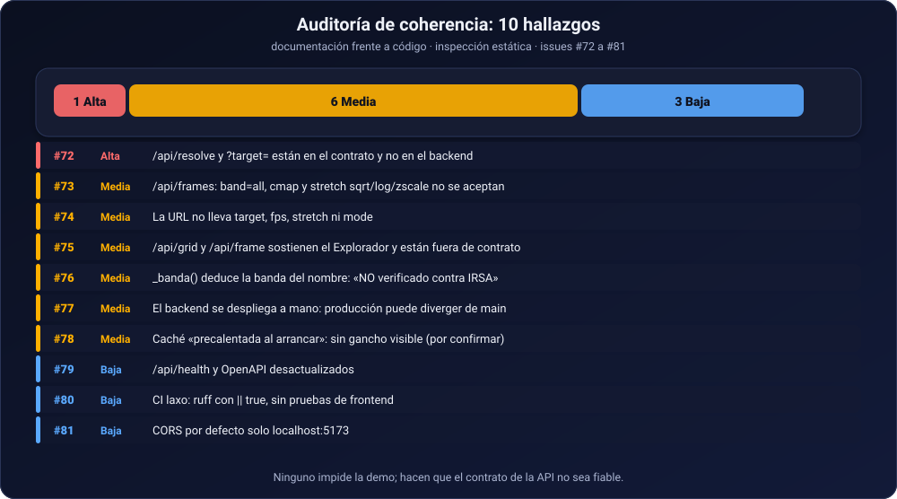

# 🛡️ 09 · Riesgos y auditoría

Dos fuentes: el registro de riesgos del equipo (`docs/07_RIESGOS.md` del repositorio oficial) y la **auditoría de coherencia** entre documentación y código que hice el 2026-11-15 con el método de deriva de EGM ([10](10_HERRAMIENTAS_Y_IA.md)).

## 📋 Riesgos que el equipo registró

Los títulos son los del registro del equipo (13 riesgos). La columna de la derecha es **mi resumen de cómo se aborda en el proyecto**, armado con el resto de la documentación; no copia el texto original, que puede decir otra cosa.

| # | Riesgo | Cómo se aborda (resumen mío) |
|---|---|---|
| R1 | Los recortes de IRSA son demasiado lentos para algo interactivo | Caché, lector por rangos, respuesta parcial con `pending`, cinco campos precalculados |
| R2 | Las épocas no son comparables por el filtro lineal variable | Agrupar por banda y longitud de onda; `wavelength_um` por fotograma |
| R3 | DR1 acaba de salir y los ejemplos no cuadran | Contrastar contra los archivos reales, no contra el reporte |
| R4 | Se cae el wifi (en la sala o en el pitch) | Modo con datos precalculados y video de respaldo |
| R5 | Se entrega tarde o incompleto | Plan por horas y congelación de alcance |
| R6 | El equipo se dispersa en viñetas a medias | Reparto por roles |
| R7 | Dos agentes se pisan y rompen `main` | Un *worktree* por persona; no se commitea a `main` |
| R8 | Alguien afirma algo falso delante del jurado | Regla «ninguna cifra sin fuente»; revisión científica |
| R9 | La GPU o el equipo local no dan para lo prometido | No se entrena ningún modelo |
| R10 | El movimiento es sub-píxel y el parpadeo no impresiona | Resta, apilado y mediana de 10 exposiciones |
| R11 | Vercel depende de una sola cuenta | Despliegue de emergencia desde otra cuenta gratuita |
| R12 | Cae el CDS de Estrasburgo (SIMBAD, VizieR) | Espejo de Harvard y estado visible con «Reintentar» |
| R13 | Una estrella saturada engaña la resta | El visor debe avisar cuando el objeto satura |

## 🔍 Auditoría de coherencia (2026-11-15)

**Método:** lectura de `AGENTS.md`, `docs/03_ARQUITECTURA.md` y `deploy/` contra `main.py`, `url.ts`, el CI y los manifiestos. **Evidencia: inspección estática**; los hallazgos no se reprodujeron contra la API viva. Complementos ejecutados: `pytest` (46 pasan), `ruff` (17 avisos E501) y `tsc --noEmit` (sin errores).

**Veredicto:** corregir antes de ampliar pruebas, por el contrato y no por un fallo en pantalla. Nada de esto impide la demo; sí hace que el contrato de la API no sea fiable.

| Issue | Gravedad | Hallazgo |
|---|---|---|
| [#72](https://github.com/mauriciovalenzuela742/SPHEREX/issues/72) | Alta | `/api/resolve` y `?target=` están en el contrato y el backend no los tiene |
| [#73](https://github.com/mauriciovalenzuela742/SPHEREX/issues/73) | Media | `/api/frames`: `band=all`, `cmap` y `stretch` sqrt/log/zscale documentados y no aceptados |
| [#74](https://github.com/mauriciovalenzuela742/SPHEREX/issues/74) | Media | La URL del visor no lleva `target`, `fps`, `stretch` ni `mode` |
| [#75](https://github.com/mauriciovalenzuela742/SPHEREX/issues/75) | Media | `/api/grid` y `/api/frame` sostienen el Explorador pero el contrato las declara fuera de contrato |
| [#76](https://github.com/mauriciovalenzuela742/SPHEREX/issues/76) | Media | `_banda()` deduce la banda del nombre del detector y se declara «NO verificado contra IRSA» |
| [#77](https://github.com/mauriciovalenzuela742/SPHEREX/issues/77) | Media | El backend oficial se despliega a mano: producción puede diverger de `main` |
| [#78](https://github.com/mauriciovalenzuela742/SPHEREX/issues/78) | Media | La caché «precalentada al arrancar» no tiene gancho de arranque visible (por confirmar) |
| [#79](https://github.com/mauriciovalenzuela742/SPHEREX/issues/79) | Baja | `/api/health` y la descripción de OpenAPI desactualizados |
| [#80](https://github.com/mauriciovalenzuela742/SPHEREX/issues/80) | Baja | CI laxo: `ruff \|\| true`, sin pruebas de frontend, `npm install` frente a `npm ci` |
| [#81](https://github.com/mauriciovalenzuela742/SPHEREX/issues/81) | Baja | CORS por defecto solo admite `localhost:5173`; falta confirmar la variable en producción |

El informe completo está en el [PR #71](https://github.com/mauriciovalenzuela742/SPHEREX/pull/71) del repositorio oficial (`ISSUES.md` y `docs/REPORTE_PRELIMINAR_EGM_2026-11-15.md`).

## 📌 Estado conocido hoy

- **Backend en producción:** `https://spherex-api.vercel.app/api/health` devolvía `0.0.1` el 2026-11-15, mientras el código está en 0.4.2: el despliegue manual no se había repetido ([#77](https://github.com/mauriciovalenzuela742/SPHEREX/issues/77)).
- **Instaladores:** sin firmar y sin probar en equipos reales.
- **Frontend:** sin pruebas automatizadas; el CI solo compila.
- **Caché en Vercel:** las funciones no tienen disco persistente, así que la caché en disco no sirve allí; para la demo se usa el precalculado.

## ✅ Lo que sí está bien

`tsc --noEmit` termina sin errores; Aladin Lite está fijada en 3.8.2 como decide `AGENTS.md`; el Dockerfile usa Python 3.11; `/api/spectrum` incluye `caveat` como exige el contrato; no hay FITS versionados; las 46 pruebas pasan sin red.
