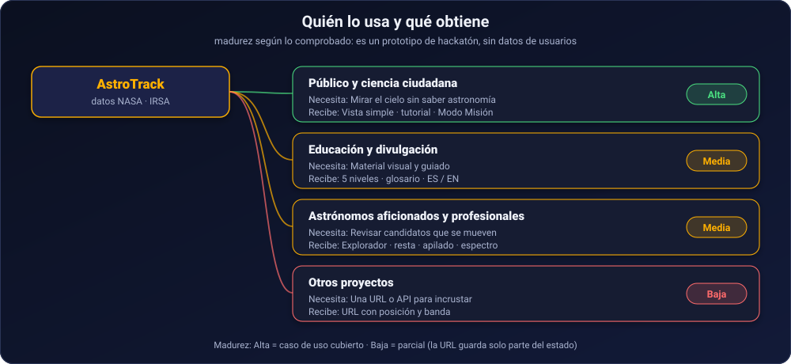

# 💼 15 · Alcance y potencial comercial

> [!IMPORTANT]
> **Este documento es un análisis, no un plan de negocio ni una promesa.** Los hechos salen del repositorio oficial y de la documentación del evento; las hipótesis de mercado y de monetización son mías y están marcadas como **[Hipótesis]**. No hay datos de usuarios reales, ingresos ni validación comercial: el proyecto nació en un hackatón de 24 horas. Antes de cualquier uso comercial, hay que verificar las condiciones vigentes de cada servicio y de los datos, y pedir asesoría legal si corresponde.

## 🎯 Qué se ofrece hoy

Una herramienta web pública, gratuita y sin cuentas, que convierte el archivo de imágenes infrarrojas de SPHEREx en algo que cualquiera puede mirar: la misma zona del cielo a lo largo del tiempo (el «videíto»), con herramientas para restar fechas, apilar visitas y ver el espectro de un objeto. Se distribuye como web, PWA y apps instalables para Windows, macOS, Linux y Android.

| Dimensión | Estado verificado |
|---|---|
| Producto | Visor funcionando en <https://spherex-planet-x-tau.vercel.app/> |
| Distribución | Web, PWA, 3 instaladores de escritorio y APK (sin firmar) |
| Idiomas | Español e inglés |
| Datos | Públicos, de la NASA vía IPAC/IRSA; sin datos propios que mantener |
| Cuentas y datos personales | Ninguno (los comentarios se guardan en el navegador) |
| Estado de madurez | Prototipo de hackatón |
| Costo de operación | Plan gratuito de Vercel y de GitHub; sin presupuesto de infraestructura |

## 👥 A quién le sirve

| Audiencia | Qué necesita | Qué le da AstroTrack | Madurez |
|---|---|---|---|
| **Público curioso y ciencia ciudadana** (modelo: Backyard Worlds) | Mirar el cielo sin saber astronomía | Vista simple, tutorial, Modo Misión | Alta para el caso de uso; sin pruebas con usuarios |
| **Educación** (colegios, divulgación, planetarios) | Material visual y guiado | Modo Misión de 5 niveles, glosario, ES/EN | Media: contenido listo, falta material para docentes |
| **Astrónomos aficionados y profesionales** | Revisar candidatos que se mueven | Explorador, resta, apilado, catálogos, espectro indicativo | Media: no es fotometría calibrada |
| **Otros proyectos** | Una URL consultable para incrustar | URL con posición y banda | Baja: la URL guarda solo parte del estado y la API no es un servicio estable documentado |

Un análisis más detallado de cada tipo de usuario, con recorridos y objetivos, está en [21 Tipos de usuario](21_TIPOS_DE_USUARIO.md) y [23 Recorridos y objetivos](23_RECORRIDOS_Y_OBJETIVOS.md).

## 🧭 Propuesta de valor frente a lo que existe

El estado del arte del propio equipo identifica un hueco: no hay una herramienta pública para SPHEREx que muestre **dos ejes a la vez**, cómo cambia una zona **en el tiempo** y cómo se ve **en cada longitud de onda**. Esa afirmación es del equipo y está limitada por lo que buscaron; si alguien encuentra lo contrario, se corrige. Ver [16 Comparativa](16_COMPARATIVA_Y_ESTADO_DEL_ARTE.md) y, para el caso de que otro equipo haya hecho algo parecido, [20 Originalidad y diferenciadores](20_ORIGINALIDAD_Y_DIFERENCIADORES.md).

## 💰 Costos y dependencias

| Pieza | Costo hoy | Nota |
|---|---|---|
| Vercel (visor, API, prototipo) | Plan gratuito (Hobby) | Tope de 100 despliegues por día para todo el equipo; se agotó el 14-nov |
| GitHub (código, releases, Pages) | Gratuito | Este repositorio y su página |
| Datos de SPHEREx (IRSA) | Gratuitos y abiertos | Sin garantía de disponibilidad: IRSA tuvo errores 503 |
| Catálogos (SIMBAD, Gaia, CatWISE) | Gratuitos | El CDS de Estrasburgo respondía a ratos desde el 9-nov (riesgo R12) |
| Firma de instaladores | **No incluida** | Windows y macOS piden certificados de pago |
| App para iPhone (App Store/TestFlight) | **99 USD al año** (cuenta Apple Developer) | No existe hoy |
| Dominio propio | No hay | Se usa el subdominio de Vercel |

**El mayor riesgo operativo** es depender de IRSA en vivo para coordenadas arbitrarias, y de un backend desplegado a mano en un plan gratuito sin disco persistente. Ver [09](09_RIESGOS_Y_AUDITORIA.md).

## ⚖️ Datos, licencias y condiciones

- **Datos:** los de la NASA y sus agencias socias son abiertos según el evento. La atribución de SPHEREx es **obligatoria y literal** (ver [04](04_DATOS_SPHEREX.md)). La página de recursos del desafío advierte además que la NASA **no respalda** a entidades externas y que hay que cumplir las condiciones de uso de cada sitio de datos.
- **Código:** el repositorio oficial lleva licencia **MIT** a nombre del equipo. Este repositorio no tiene licencia propia aún; es una decisión pendiente de quien lo publica.
- **Marca y nombre:** «AstroTrack» es el nombre elegido por el equipo (antes «AstroTRACK» y «Planet X»); no se comprobó si hay otro producto con el mismo nombre ni se registró.
- **Vercel Hobby:** los planes gratuitos suelen estar pensados para uso personal y no comercial. **[A verificar]** en las condiciones vigentes del proveedor antes de cualquier uso con fines de lucro.
- **Logos y marcas de terceros** (NASA, JPL, Caltech): el visor no debe sugerir respaldo oficial.

## 💡 Caminos posibles (hipótesis, no validadas)

> [!NOTE]
> Ninguno de estos caminos se probó. Son ideas para evaluar, con lo que haría falta en cada una.

| Camino | Idea | Qué haría falta | Riesgo principal |
|---|---|---|---|
| **A. Bien público** [Hipótesis] | Mantenerlo gratuito y abierto, como WiseView lo fue para Backyard Worlds | Hosting estable y alguien que lo mantenga | Costo y tiempo sin retorno directo |
| **B. Educación** [Hipótesis] | Paquetes para colegios y divulgación: guías docentes, niveles, cuadernillos | Contenido pedagógico, validación con docentes | Venta lenta; precio bajo |
| **C. Apoyo institucional** [Hipótesis] | Fondos de ciencia ciudadana, universidades o centros de divulgación | Informe de impacto, usuarios reales | Depende de ciclos de postulación |
| **D. Servicio para otros proyectos** [Hipótesis] | Una API estable de recortes y parpadeos | Contrato congelado, límites, caché propia, soporte | Costo de infraestructura y de IRSA |
| **E. Insignia profesional** | Portafolio y casos de estudio | Nada nuevo | No genera ingresos del producto |

## 🛣️ Qué faltaría para un uso serio

1. **Corregir el contrato de la API** y congelarlo ([#72–#79](https://github.com/mauriciovalenzuela742/SPHEREX/issues)).
2. **Desplegar el backend con un proceso repetible** (hoy es manual) y medir su disponibilidad.
3. **Pruebas de usuario** con personas que no saben astronomía (el supuesto central del producto nunca se midió).
4. **Pruebas automáticas del visor** y en equipos reales, en especial iPhone y los instaladores.
5. **Firmar los instaladores** o dejar de ofrecerlos si el costo no se justifica.
6. **Revisión científica independiente** de lo que el visor afirma (ya hubo una el 15-nov que corrigió textos sobre los hielos).
7. **Decisiones de licencia, marca y términos** de servicio.

## 🚫 Qué no afirmar

- No decir que tiene usuarios, descargas o impacto medidos: no hay datos.
- No decir que es una herramienta de calidad científica: los espectros son indicativos.
- No decir que está respaldado por la NASA, el JPL o Caltech.
- No decir que está «listo para producción»: es un prototipo de hackatón con riesgos conocidos.
- No decir que hay app para iPhone.

Ver también [14 Preguntas y respuestas](14_PREGUNTAS_FRECUENTES.md) y [17 Hoja de ruta](17_HOJA_DE_RUTA.md).
