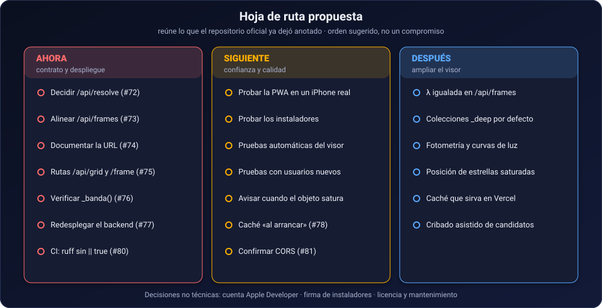

# 🛣️ 17 · Hoja de ruta propuesta

> [!NOTE]
> **Es una propuesta mía, no el plan del equipo.** Reúne lo que el repositorio oficial ya deja anotado como pendiente (sus documentos y los issues de la auditoría) y lo ordena por urgencia. Cada ítem dice de dónde sale. El equipo no se ha comprometido con este orden y yo no decido sobre el repositorio oficial.

## 🔥 Ahora: dejar el contrato y el despliegue en orden

Es trabajo de documento y de proceso; nada de esto cambia lo que ve la persona usuaria.

| # | Qué | De dónde sale | Esfuerzo estimado |
|---|---|---|---|
| 1 | Decidir `/api/resolve` y `?target=`: implementarlos o quitarlos del contrato | [#72](https://github.com/mauriciovalenzuela742/SPHEREX/issues/72) | Bajo si se quita; medio si se implementa |
| 2 | Alinear la tabla de `/api/frames` (`band=all`, `cmap`, estiramientos) con lo que acepta el código | [#73](https://github.com/mauriciovalenzuela742/SPHEREX/issues/73) | Bajo |
| 3 | Documentar los parámetros reales de la URL y decidir si agregar `target`, `fps`, `stretch`, `mode` | [#74](https://github.com/mauriciovalenzuela742/SPHEREX/issues/74) | Bajo a medio |
| 4 | Decidir si `/api/grid` y `/api/frame` pasan al contrato, y fijar con una prueba que existen | [#75](https://github.com/mauriciovalenzuela742/SPHEREX/issues/75) | Bajo |
| 5 | Verificar `_banda()` contra IRSA con un detector real y avisar en vez de descartar épocas | [#76](https://github.com/mauriciovalenzuela742/SPHEREX/issues/76) | Bajo |
| 6 | **Redesplegar el backend** (producción decía 0.0.1) y hacer que `/api/health` informe la versión | [#77](https://github.com/mauriciovalenzuela742/SPHEREX/issues/77) | Bajo, pero lo hace quien tenga acceso a Vercel |
| 7 | Quitar el `\|\| true` de `ruff` tras acortar 17 líneas; usar `npm ci` en CI | [#80](https://github.com/mauriciovalenzuela742/SPHEREX/issues/80) | Bajo |

## 🔜 Siguiente: confianza y calidad

| # | Qué | De dónde sale |
|---|---|---|
| 8 | **Probar la PWA en un iPhone real** (ícono, pantalla completa, service worker) | Issue #70 del oficial: nadie la ha probado |
| 9 | Probar los instaladores de Windows, macOS, Linux y Android en equipos reales | `native/README.md`: «sin verificar» |
| 10 | Pruebas automáticas del visor (hoy no hay) y una que fije las rutas de la API que usa | [#80](https://github.com/mauriciovalenzuela742/SPHEREX/issues/80), [05 Backend](05_BACKEND.md) |
| 11 | Pruebas con personas que no saben astronomía (el supuesto central nunca se midió) | [15 Alcance comercial](15_ALCANCE_COMERCIAL.md) |
| 12 | Que el visor **avise cuando el objeto satura** (Barnard, RW Aur) | Riesgo R13 y [08 Hallazgos](08_HALLAZGOS_CIENTIFICOS.md) |
| 13 | Aclarar o implementar el «precalentado al arrancar» de la caché | [#78](https://github.com/mauriciovalenzuela742/SPHEREX/issues/78) |
| 14 | Confirmar `CORS_ORIGINS` en producción | [#81](https://github.com/mauriciovalenzuela742/SPHEREX/issues/81) |

## 🔭 Después: ampliar lo que el visor puede mostrar

Pendientes que el propio equipo dejó anotados en `docs/03` y `docs/09`:

- **Pedir longitud de onda igualada** en `/api/frames` (el EDA demostró que baja la dispersión de 0,474 a 0,035 µm; falta ofrecerlo en la API).
- **Colecciones `_deep` por defecto**: R Draconis tiene 1.233 + 733 archivos profundos contra 422 + 126 normales, y la consulta por defecto casi no lo ve.
- **Medir brillo (fotometría)** para las curvas de luz de RW Aur y R Draconis: nunca se midió.
- **Medir la posición de una estrella saturada** (ajuste de PSF a las alas o un detector donde no sature).
- **Caché que sirva en Vercel**: las funciones no tienen disco persistente; hace falta caché en memoria o almacenamiento externo.
- **Cribado asistido** de candidatos con redes pequeñas sobre recortes (el modelo es ALeRCE), siempre encima del visor y no en lugar de él.

## 🍎 Decisiones que no son técnicas

| Decisión | Quién decide | Nota |
|---|---|---|
| ¿Conseguir una cuenta Apple Developer para TestFlight? | El equipo | Sin ella no hay app nativa para iPhone ([07](07_APPS_NATIVAS_Y_RELEASES.md)) |
| ¿Firmar los instaladores o dejar de ofrecerlos? | El equipo | Costo frente a utilidad ([15](15_ALCANCE_COMERCIAL.md)) |
| ¿Qué licencia y condiciones tiene este repositorio de descargas y documentación? | Quien lo publica | Hoy no tiene licencia propia |
| ¿Quién mantiene el backend y cómo se despliega? | El equipo | Hoy es manual y depende de una cuenta |

## 🔁 Qué mantener en este repositorio

- Publicar cada release nuevo aquí con sus sumas (ver [07](07_APPS_NATIVAS_Y_RELEASES.md#-cómo-publicar-un-release-nuevo-resumen)).
- Actualizar el About del repositorio (lleva la versión y el conteo de releases) y el [CHANGELOG](../CHANGELOG.md).
- Rehacer la «fotografía» de esta documentación si el repositorio oficial cambia mucho; el índice indica el commit estudiado.
