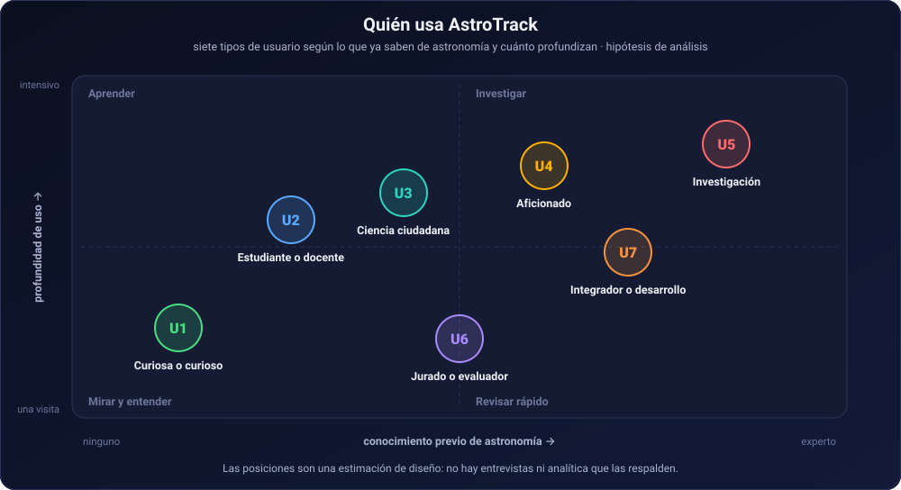
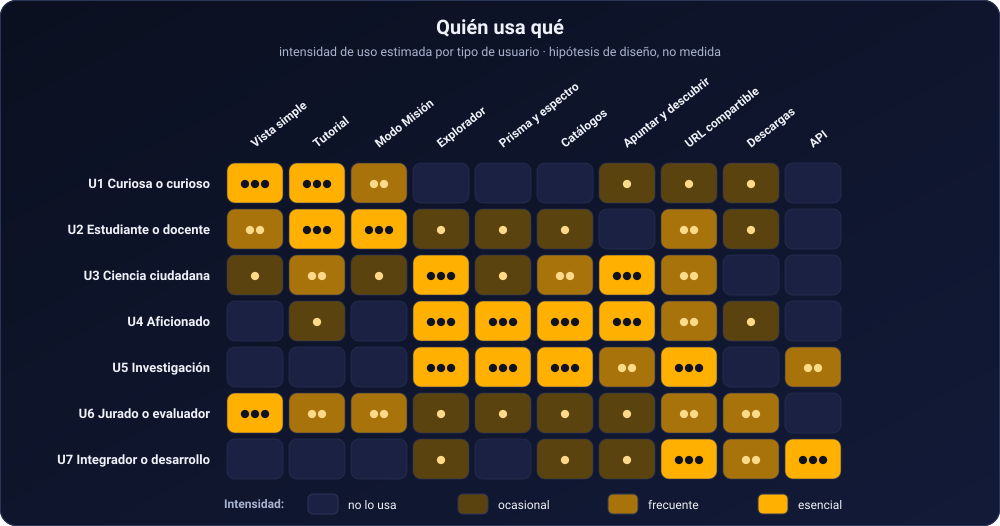

# 🧑‍🤝‍🧑 21 · Tipos de usuario

AstroTrack tiene muchas funciones: portada, vista simple, Modo ciencia, Explorador, Prisma, Modo Misión, tutorial, catálogos, comentarios, URL, API, descargas. No son para la misma persona. Este documento identifica **siete tipos de usuario**, qué busca cada uno, qué partes de la herramienta le sirven y dónde hoy no está bien servido.

> [!IMPORTANT]
> **Son hipótesis de análisis, no resultados de investigación.** No hay entrevistas, encuestas ni analítica del visor (el código no recoge ninguna). Las personas salen de tres fuentes: lo que el equipo escribió sobre su público («cualquiera», ciencia ciudadana como Backyard Worlds), lo que las funciones del código sugieren y mi lectura. Antes de tomar decisiones de producto con esto, hay que validarlo con personas reales ([23 Recorridos y objetivos](23_RECORRIDOS_Y_OBJETIVOS.md) propone cómo).

## 📌 Resumen

| | Tipo | Qué quiere | Dónde entra | Funciones centrales | Servido hoy |
|---|---|---|---|---|---|
| **U1** | Curiosa o curioso | Entender qué es esto en un minuto | Portada y vista simple | Tutorial, imagen grande, fechas, barra «Luz», «Compara dos fechas» | 🟢 Bien, sin probar con gente |
| **U2** | Estudiante o docente | Aprender o enseñar cómo se descubre algo en el cielo | Modo Misión | 5 niveles, glosario, enlace por nivel, ES/EN | 🟡 Contenido listo; falta material para docentes |
| **U3** | Ciencia ciudadana | Ayudar a encontrar objetos que se mueven | Explorador | Resta, apilado, catálogos, «¿Qué hay aquí?», zona al azar | 🟡 Herramientas sí; falta flujo para reportar candidatos |
| **U4** | Aficionado | Revisar un objeto con herramientas de verdad | Modo ciencia | Explorador, Prisma, catálogos, Apuntar | 🟡 Funciones sí; se ocultaron dos secciones del Prisma |
| **U5** | Investigación profesional | Mirar rápido o preparar una observación con datos fiables | Modo ciencia y API | Explorador, espectro, URL, API | 🔴 No es su herramienta: espectro indicativo |
| **U6** | Jurado o evaluador | Entender y juzgar en dos minutos | Portada, vista simple, demo | Los cinco objetos de prueba, Modo Misión, descargas | 🟢 Bien: está pensado para eso |
| **U7** | Integrador o desarrollo | Reusar la herramienta o instalarla | URL, API, releases | `?ra=&dec=`, `/api/epochs`, `/api/frames`, instaladores | 🟡 Documentado en [03](03_API.md); contrato con diferencias |

Leyenda: 🟢 bien servido · 🟡 servido con huecos · 🔴 no es la herramienta adecuada.

El «servido hoy» sale de lo que muestran el código y la documentación ([22 Mapa de funciones](22_MAPA_DE_FUNCIONES.md)); no de pruebas con personas.

---

## U1 · Curiosa o curioso 🌟

**Quién es:** alguien que llegó por un enlace, una redes sociales, una charla o el pitch. Sin formación astronómica. Probablemente desde el móvil.

**Su objetivo:** entender, en uno o dos minutos, qué está viendo y por qué importa. «Ver moverse una estrella».

**Ruta recomendada:** portada → «Empecemos con un tutorial» (Spherix) → vista simple con Epsilon Indi B → «Compara dos fechas» → copiar el enlace.

**Funciones que usa:** tutorial de la vista simple, la imagen grande con el objeto marcado, las fechas por pasada (~6 meses), la barra «Luz» (normal, cercana, media, lejana), «Compara dos fechas» (A − B), los botones de los cinco objetos.

**Qué podría frustrarlo**
- Una imagen de 6″ por píxel se ve borrosa, y un movimiento de 1 a 2 píxeles es sutil ([08 Hallazgos](08_HALLAZGOS_CIENTIFICOS.md)).
- Que un objeto no cargue: IRSA falla a ratos (503); existe «Reintentar» y datos precalculados para los cinco objetos de prueba.
- Que en estrellas muy brillantes la resta muestre un par aunque no se muevan (saturación), y que el visor todavía no lo avise.
- Esperar a coordenadas arbitrarias: pueden tardar.

**Cómo se sabría que le fue bien:** [Hipótesis] ve un movimiento y puede explicarlo con sus palabras en menos de dos minutos.

**Cobertura:** 🟢. Es el público para el que se diseñó la vista simple, pero **nunca se probó con personas nuevas**.

## U2 · Estudiante o docente 🎓

**Quién es:** una persona en un colegio, universidad o divulgación; o quien enseña. Busca una actividad guiada, no una herramienta abierta.

**Su objetivo:** aprender cómo se descubre algo en el cielo comparando fotos (la historia de Tombaugh y Plutón), o conducir una clase.

**Ruta recomendada:** enlace directo al Modo Misión → introducción (1930, el parpadeo, «ahora te toca a ti») → cinco niveles → cierre «¡Lo lograste!» → compartir el enlace de un nivel.

**Los cinco niveles** (por objeto de prueba): La estrella con prisa (Barnard), La enana marrón invisible (WISE 0855), Dos enanas que viajan juntas (eps Ind B), ¿Todo lo que aparece en la resta se movió? (RW Aur, «nivel de la duda») y El latido de R Draconis.

**Funciones que usa:** Modo Misión, glosario con términos al pasar el mouse, enlace por nivel (`?mision=1…5`), español e inglés, el tutorial.

**Qué podría frustrarlo:** no hay guía para docentes, ni hojas de trabajo, ni forma de ver el avance de un curso; el nivel de la duda y la saturación requieren explicación; los niveles dependen de datos de IRSA en vivo salvo los precalculados.

**Éxito:** [Hipótesis] completa los cinco niveles y puede explicar por qué una estrella saturada «engaña» la resta.

**Cobertura:** 🟡. El contenido existe; faltan materiales de apoyo y una validación pedagógica.

## U3 · Ciencia ciudadana 🔭

**Quién es:** una persona con tiempo y ganas que quiere ayudar de verdad, como los voluntarios de Backyard Worlds (cientos de miles, con muchos descubrimientos de cometas y enanas marrones).

**Su objetivo:** recorrer campos y detectar candidatos que se mueven o cambian de brillo, y poder decir «esto es interesante».

**Ruta recomendada:** Modo ciencia → «Explorar una zona al azar» → Explorador (resta, apilar visitas) → catálogos («¿ya tiene nombre?») → «¿Qué hay aquí?» → comentario.

**Funciones que usa:** Apuntar (grados o sexagesimal), zona al azar, «¿Qué hay aquí?» (SIMBAD), Explorador, catálogos Gaia/CatWISE/SIMBAD (con CatWISE que marca candidatos que se mueven y no están en SIMBAD), comentarios.

**Qué podría frustrarlo**
- **No hay un flujo para reportar un candidato** (exportarlo o enviarlo a otro proyecto). Los comentarios se guardan solo en su navegador.
- Que el movimiento no se pueda confirmar sin conocer la saturación ni la longitud de onda.
- La velocidad: cada campo nuevo tarda.

**Éxito:** [Hipótesis] distingue movimiento real de ruido o saturación y puede compartir lo que encontró.

**Cobertura:** 🟡. Las herramientas están; falta el ciclo de «encontrar → registrar → compartir».

## U4 · Aficionado 🌌

**Quién es:** alguien con práctica en astronomía amateur: sabe qué son RA/Dec, una banda y un espectro. Quiere usar un objeto concreto.

**Su objetivo:** revisar un objeto o una zona con herramientas que no limiten, y entender de qué está hecho.

**Ruta recomendada:** Modo ciencia → coordenadas → Explorador (resta A − B, apilar «quieto» y «siguiendo el movimiento») → Prisma (Ojo infrarrojo, huella espectral, qué cambió, ficha del astro) → catálogos.

**Funciones que usa:** todo el Explorador, el Prisma, el deslizador de longitud de onda del cubo, catálogos, trayectoria con aros y flecha, la URL para guardar lo que ve.

**Qué podría frustrarlo:** el espectro es indicativo, no calibrado; **dos secciones del Prisma están ocultas por decisión del equipo** («Seguir un astro por su huella espectral» y «El fondo del cielo», aunque las notas del release v0.4.0 las mencionan); la URL guarda solo parte del estado ([#74](https://github.com/mauriciovalenzuela742/SPHEREX/issues/74)).

**Éxito:** [Hipótesis] confirma con las herramientas lo que sospechaba, con las advertencias de saturación a la vista.

**Cobertura:** 🟡.

## U5 · Investigación profesional 🧪

**Quién es:** una persona astrónoma. Conoce los datos y tiene herramientas propias.

**Su objetivo:** mirar rápido una posición, o preparar una observación, con datos fiables. Cuando necesita fotometría calibrada usa la herramienta de IRSA.

**Ruta recomendada:** URL con `ra`/`dec` → Explorador → espectro → o directamente la API.

**Funciones que usa:** URL consultable, Explorador, espectro al vuelo, `/api/frames`, `/api/spectrum`.

**Qué podría frustrarlo:** los espectros son **indicativos y lo dicen** (`caveat`); no hay fotometría de calidad científica; la API tiene diferencias con su contrato ([03](03_API.md)); la longitud de onda igualada no se puede pedir todavía.

**Éxito:** [Hipótesis] le sirve como visor rápido y reconoce sus límites.

**Cobertura:** 🔴 como herramienta de medición; 🟡 como visor. El propio equipo lo dice: no es una herramienta de calidad científica.

## U6 · Jurado o evaluador ⚖️

**Quién es:** quien evalúa el proyecto: un jurado local con poco tiempo, luego personas expertas de la NASA o agencias socias. Puede ser una evaluación institucional o comercial.

**Su objetivo:** entender el aporte en dos minutos, comprobar que funciona y que lo que se afirma es cierto.

**Ruta recomendada:** enlace → portada → vista simple con un objeto de prueba → un ejemplo de resta → Modo Misión → revisar descargas y documentación.

**Funciones que usa:** los cinco objetos con datos precalculados, la vista simple, el Modo Misión, «Descargas», el README y esta documentación.

**Qué podría frustrarlo:** que un objeto no cargue; que no haya enlace funcional desde un móvil; que haya afirmaciones sin respaldo. Por eso los documentos lo dicen todo: [19 El pitch y la entrega](19_PITCH_Y_ENTREGA.md), [20 Originalidad](20_ORIGINALIDAD_Y_DIFERENCIADORES.md).

**Éxito:** entiende qué hace, ve que funciona y confía en lo que se afirma.

**Cobertura:** 🟢. Es el usuario para el que se preparó la demo.

## U7 · Integrador o desarrollo 🛠️

**Quién es:** quien quiere incrustar o reusar la herramienta (un sitio web, un proyecto de ciencia ciudadana), o instalar las apps; o una persona que mantiene el proyecto.

**Su objetivo:** una URL que abra el visor en una posición, una API estable, instaladores confiables.

**Ruta recomendada:** README → [03 API](03_API.md) → probar `/api/epochs` y `/api/frames` → armar enlaces con `?ra=…&dec=…&size=…&band=…` → releases y sumas SHA-256.

**Funciones que usa:** URL, API, releases con sumas, vista «Descargas».

**Qué podría frustrarlo:** `/api/resolve` documentado y no implementado ([#72](https://github.com/mauriciovalenzuela742/SPHEREX/issues/72)); parámetros que el contrato promete y el código rechaza ([#73](https://github.com/mauriciovalenzuela742/SPHEREX/issues/73)); URL incompleta ([#74](https://github.com/mauriciovalenzuela742/SPHEREX/issues/74)); rutas fuera de contrato que sostienen el visor ([#75](https://github.com/mauriciovalenzuela742/SPHEREX/issues/75)); instaladores sin firmar.

**Éxito:** [Hipótesis] integra el visor con un enlace y no necesita preguntar.

**Cobertura:** 🟡. Hay documentación y releases; falta un contrato congelado.

---

## 🚫 Quién no es el público (por ahora)

| Persona | Por qué no | Qué usaría en su lugar |
|---|---|---|
| Quien necesita **fotometría calibrada** | Los espectros son indicativos | Spectrophotometry Tool de IRSA |
| Quien espera **detección automática** | Es un visor, no un detector | Brokers y herramientas de enlazado (ALeRCE, HelioLinC; ver [16](16_COMPARATIVA_Y_ESTADO_DEL_ARTE.md)) |
| Quien espera una **app nativa en iPhone** | No existe (Apple exige cuenta de pago) | La versión web instalable desde Safari |
| Quien **no tiene internet** | Los datos vienen de servicios en línea | — |
| Quien necesita **cuentas, historial o equipos** | No hay cuentas por diseño | — |

## ♿ Dimensiones transversales

| Dimensión | Estado |
|---|---|
| **Idioma** | Español e inglés (selector); el tutorial y los errores también |
| **Dispositivo** | Web de escritorio y móvil, PWA, apps de escritorio y Android; el uso en iPhone solo por PWA y sin probar en un equipo real |
| **Movimiento** | Respeta `prefers-reduced-motion`: el parpadeo automático se apaga y se ofrece «Alternar época» |
| **Conexión** | Necesita internet; los cinco campos de prueba cargan precalculados |
| **Accesibilidad** | Hay textos de ayuda, botones de 44 px en móvil y foco visible; **no se hizo una revisión formal de accesibilidad** |
| **Experiencia previa** | Cubierta por los niveles: mirar, aprender, investigar, integrar ([22](22_MAPA_DE_FUNCIONES.md)) |

## 🧭 Cómo usar este documento

1. Elige a quién le hablas antes de decidir qué mostrar (en una demo, U1 y U6; en un aula, U2).
2. Si tocas una función, mira en [22](22_MAPA_DE_FUNCIONES.md) a qué tipos de usuario afecta.
3. Valida las hipótesis con 5 a 8 personas por tipo antes de invertir en algo grande ([23](23_RECORRIDOS_Y_OBJETIVOS.md)).
4. Convierte lo que aprendas en [casos de uso y criterios de aceptación](24_CASOS_DE_USO.md).
