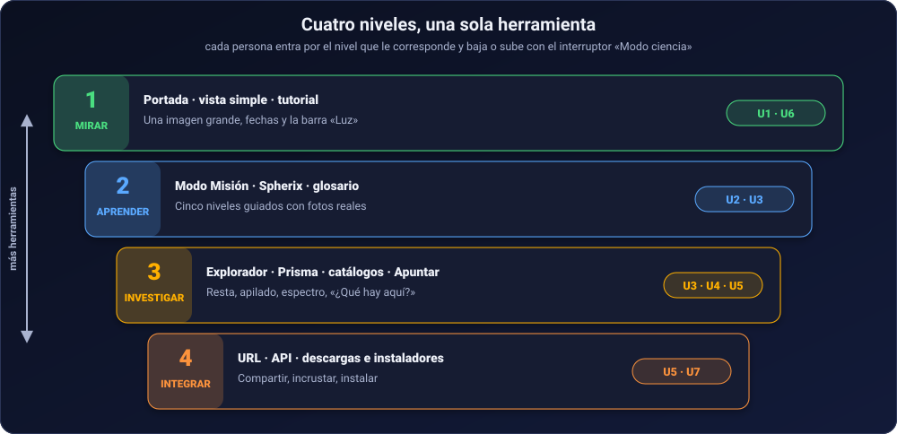
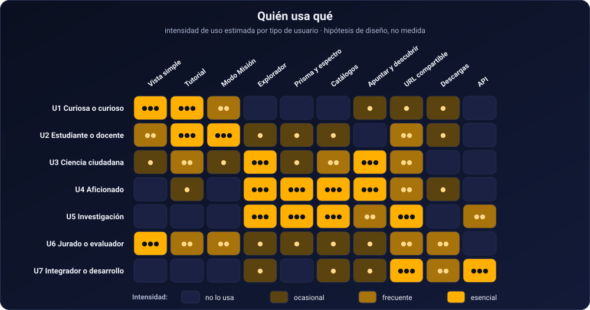

# 🗺️ 22 · Mapa de funciones

AstroTrack tiene mucho: más de 12.000 líneas de TypeScript y una API con varios endpoints. Este documento las ordena en **cuatro niveles de uso**, dice dónde vive cada función en el código y a qué tipo de usuario ([21](21_TIPOS_DE_USUARIO.md)) le sirve.

> [!NOTE]
> **Fuente y alcance.** Hecho por lectura del código del repositorio oficial (`main`, `5b599b9`) y de sus documentos. **No operé el visor función por función.** «Estado» dice lo que el código muestra; las únicas cosas que ejecuté yo son las pruebas del backend (46, pasan) y la vista «Descargas». Las carpetas son del repositorio oficial (`scaffold/frontend/src/…`).

<p align="center"></p>

## 🧭 Cómo se pasa de un nivel a otro

```
Portada ──► Vista simple ◄──── interruptor «Modo ciencia» ────► Modo ciencia (Visor completo)
   │                                                                  │
   ├──► Modo Misión (?mision=intro…fin) ──────────────────────────────┤
   ├──► Tutorial: ?tutorial=simple | ?tutorial=1                      │
   └──► Descargas (?vista=descargas)        Menú ☰: Inicio, Visor, Modo Misión, Tutorial, Descargas, Repositorio
```

La vista queda en la URL: `?vista=`, `?ciencia=1`, `?mision=`, `?tutorial=` ([03](03_API.md#-url-de-la-aplicación)).

---

## 1️⃣ Nivel MIRAR · portada, vista simple y tutorial

| Función | Qué hace | Dónde | Para | Estado |
|---|---|---|---|---|
| **Portada** | Cielo animado, qué es AstroTrack, botones de tutorial, «Empecemos», Modo Misión y Descargas | `pages/Landing.tsx`, `pages/landing/` | U1 U6 | Por lectura; vista previa en local |
| **Vista simple** | Una imagen grande de SPHEREx con el objeto marcado, sin herramientas | `simple/Simple.tsx` | U1 U2 U6 | Por lectura |
| **Fechas por pasada** | Una fecha por cada pasada de ~6 meses, desde abril de 2025; reproducir y pausa | `simple/Simple.tsx` | U1 U6 | Por lectura |
| **Barra «Luz»** | Normal (promedio de las 6 bandas, blanco y negro), cercana, media o lejana (bandas teñidas de su color) | `simple/Simple.tsx` | U1 U6 | Por lectura |
| **«Compara dos fechas» (A − B)** | Resta entre dos fechas | `simple/Simple.tsx` | U1 U6 | Por lectura |
| **¿Dónde? / ¿Cuándo?** | Elegir posición (A.R./Dec o los cinco objetos) y fecha | `simple/Simple.tsx`, `apuntar/` | U1 | Por lectura |
| **Reintentar** | Botón cuando no cargan las fotos | `simple/Simple.tsx` | todas | Por lectura |
| **Tutorial de la vista simple** | Recorrido guiado por Spherix, empieza y termina en Epsilon Indi B | `tutorial/`, `content/tutorial.ts` | U1 | Por lectura |
| **Interruptor «Modo ciencia»** | Pasa a la vista completa con transición difuminada | `simple/InterruptorCiencia.tsx` | U3 U4 | Por lectura |

## 2️⃣ Nivel APRENDER · Modo Misión, Spherix y glosario

| Función | Qué hace | Dónde | Para | Estado |
|---|---|---|---|---|
| **Modo Misión** | Introducción de 3 pasos (1930, Tombaugh, el parpadeo) y 5 niveles con fotos reales, cierre «¡Lo lograste!» | `mision/`, `content/mision.ts` | U2 U1 | Por lectura |
| **Los 5 niveles** | Barnard, WISE 0855, eps Ind B, RW Aur («nivel de la duda») y R Draconis, con preguntas y explicación | `content/mision.ts` | U2 | Por lectura; WISE 0855 y eps Ind B usan 10 exposiciones por visita |
| **Enlace por nivel** | Cada paso es compartible (`?mision=1…5`) | `state/url.ts` | U2 | Por lectura |
| **Comparador** | El parpadeo de Tombaugh con primera y última visita | `mision/Comparador.tsx` | U2 | Por lectura |
| **Glosario** | Términos `[[así]]` con explicación al pasar el mouse o con el teclado | `mision/Glosario.tsx` | U1 U2 | Por lectura |
| **Spherix** | Mascota con chat flotante; motor **determinista** (sin modelo de lenguaje) | `spherix/` | U1 U2 | Por lectura |
| **Tutorial del Modo ciencia** | ~15 pasos que iluminan cada sección: búsqueda, objetos, mapa, épocas, λ, catálogos, Explorador y Prisma | `tutorial/`, `content/tutorial.ts` | U3 U4 | Por lectura |
| **Español e inglés** | Selector ES/EN en el encabezado | `state/idioma.tsx`, `content/textos.ts` | todas | Por lectura |

## 3️⃣ Nivel INVESTIGAR · Modo ciencia

### 🔭 Apuntar y descubrir

| Función | Qué hace | Dónde | Para | Estado |
|---|---|---|---|---|
| **A.R./Dec** | Acepta grados («133.795», «133,795») o sexagesimal; muestra «= 22h 04m…» | `apuntar/coordenadas.ts` | U3 U4 | Por lectura |
| **Cinco objetos de prueba** | Atajos que centran en la posición propagada de hoy | `content/campos.ts` | todas | Por lectura |
| **¿Qué hay aquí?** | Qué objeto de SIMBAD hay en un punto (corrige la época de la posición) | `apuntar/queHayAqui.ts` | U3 U4 | Por lectura |
| **Zona al azar** | Punto al azar lejos del plano de la Vía Láctea (usa coordenadas galácticas) | `apuntar/galactica.ts` | U3 | Por lectura |
| **Espectro del punto** | Panel de «modo descubrimiento»: espectro 0,75–5 µm y tipo probable (`clasificar()`) | `apuntar/PanelEspectro.tsx` | U3 U4 | Por lectura; orientativo |

### 🌌 El mapa del cielo

| Función | Qué hace | Dónde | Para | Estado |
|---|---|---|---|---|
| **Mapa en Aladin** | Cielo con el cubo HiPS de SPHEREx DR1 (102 planos) | `sky/AladinView.tsx` | U3 U4 | Por lectura |
| **Deslizador de λ** | Recorre los 100 planos con imagen (50 y 51 vacíos) | `sky/LambdaSlider.tsx`, `SelectorLambda.tsx` | U4 | Por lectura |
| **Épocas** | Parpadeo SPHEREx (2025–26) contra 2MASS (1997–2001) o AllWISE (~2010) | `sky/Epocas.tsx` | U3 U4 | Por lectura |
| **Catálogos** | Gaia, CatWISE y SIMBAD sobre el mapa, con estado visible y «Reintentar»; CatWISE marca candidatos que se mueven | `sky/capas/` | U3 U4 | Por lectura |
| **Trayectoria** | Aros de época y flecha hacia dónde se mueve; marca del objetivo | `sky/capas/trayectoria.ts`, `objetivo.ts` | U3 U4 | Por lectura |
| **Reducir movimiento** | Si el sistema lo pide, apaga el parpadeo y ofrece «Alternar época» | `sky/movimiento.ts` | todas | Por lectura |

### 🎞️ El Explorador (imágenes por fecha y banda)

| Función | Qué hace | Dónde | Para | Estado |
|---|---|---|---|---|
| **Modos Imagen / Resta vs t₀ / Color** | Brillo con escala común; resta contra la primera fecha; color (primera en rojo, actual en cian) | `explorador/Explorador.tsx`, `render.ts` | U3 U4 U5 | Por lectura |
| **Resta A − B** | Resta entre dos fechas cualesquiera | `explorador/` | U3 U4 | Por lectura |
| **Apilar visitas** | Mediana de varias exposiciones, quieta o siguiendo el movimiento propio | `explorador/apilar.ts`, `PanelApilar.tsx` | U3 U4 | Por lectura |
| **Limpiar estrellas** | Resta espectral B5–6 − α·B1–3 sobre las pilas por pasada | `explorador/PanelLimpieza.tsx` | U4 | Por lectura |
| **Línea de tiempo, rejilla y panel de bandas** | Navegar por fecha, ver todas las visitas y elegir la banda | `explorador/` | U3 U4 | Por lectura |
| **Zoom y movimiento del lienzo** | Pellizcar, arrastrar, «volver a la mira» | `explorador/Explorador.tsx` | todas | Por lectura |
| **Preset de objetos débiles** | WISE 0855 y eps Ind B abren con banda 5 y mediana de 10 | `explorador/presets.ts` | U1 U2 U6 | Por lectura |
| **Mensajes de error legibles** | Traduce los errores del servidor | `explorador/errores.ts` | todas | Por lectura |

### 🔬 El Prisma (varias bandas a la vez)

| Función | Qué hace | Dónde | Para | Estado |
|---|---|---|---|---|
| **Ojo infrarrojo** | El campo en «color traducido»: D1+D2 azul, D3+D4 verde, D5+D6 rojo | `prisma/OjoInfrarrojo.tsx` | U4 | Por lectura |
| **Huella espectral** | Brillo en cada foto ordenado por λ, sobre la barra del espectro | `prisma/HuellaEspectral.tsx` | U4 U5 | Por lectura; indicativa |
| **Qué cambió** | Razón de flujo por tramo de λ entre la primera y la última pasada | `prisma/QueCambio.tsx` | U4 | Por lectura |
| **Ficha del astro** | Tipo probable según la forma del espectro, con confianza | `prisma/FichaAstro.tsx`, `clasificar.ts` | U3 U4 | Por lectura; orientativa |
| **Moléculas** | ¿Falta luz en la zona de una molécula? | `prisma/moleculas.ts` | U4 | Por lectura |
| **«Seguir un astro por su huella» y «El fondo del cielo»** | Resultados del análisis de huella entre pasadas | `prisma/HuellaPasadas.tsx`, `FondoCielo.tsx` | U4 | ⚠️ **Ocultas** en el visor (los archivos siguen en el repo) |

### 💬 Comentarios

| Función | Qué hace | Dónde | Para | Estado |
|---|---|---|---|---|
| **Comentarios del público** | Se guardan en el navegador (`localStorage`) agrupados por objeto; hay un `comments.json` estático de lectura | `comentarios/` | U3 U4 | Por lectura |

## 4️⃣ Nivel INTEGRAR · URL, API y descargas

| Función | Qué hace | Dónde | Para | Estado |
|---|---|---|---|---|
| **URL compartible** | `?ra=&dec=&size=&band=` (y `mision`, `tutorial`, `ciencia`, `vista`) | `state/url.ts` | U5 U7 | Parcial: sin `target`, `fps`, `stretch` ni `mode` ([#74](https://github.com/mauriciovalenzuela742/SPHEREX/issues/74)) |
| **Vista «Descargas»** | Botones por plataforma, detección del dispositivo, guía de iPhone; toma el último release de GitHub | `pages/Descargas.tsx` | U1 U6 U7 | **Comprobada** (corrí la vista en local y en producción) |
| **PWA** | Instalable; `sw.js` cachea solo el *shell* | `public/manifest.webmanifest`, `sw.js` | todas | Por lectura |
| **Instaladores** | Windows, macOS, Linux (Tauri) y Android (Capacitor) | `native/` | U7 | **Comprobados** por dentro (versión 0.4.2); sin firmar y sin probar en equipos |
| **`/api/epochs`** | Qué observaciones hay para una posición | `scaffold/backend/app/main.py` | U5 U7 | 46 pruebas de backend pasan |
| **`/api/frames`** | Fotogramas renderizados (resta, apilado, por barrido) | idem | U5 U7 | Con diferencias frente al contrato ([#73](https://github.com/mauriciovalenzuela742/SPHEREX/issues/73)) |
| **`/api/spectrum`** | Espectro al vuelo con `caveat` obligatorio | idem | U5 U7 | Indicativo |
| **`/api/demo`, `/api/health`** | Campos precalculados y vida del servicio | idem | U7 | `irsa_reachable` siempre `null` ([#79](https://github.com/mauriciovalenzuela742/SPHEREX/issues/79)) |

---

## 📊 Quién usa qué

<p align="center"></p>

La matriz es una estimación de diseño; ver el supuesto en [21](21_TIPOS_DE_USUARIO.md).

## 🕳️ Brechas que salen del mapa

| Brecha | Afecta a | Dónde se anota |
|---|---|---|
| El visor **no avisa cuando un objeto satura** (Barnard, RW Aur), y la resta puede engañar | U1 U2 U3 U4 | Riesgo R13, [17 Hoja de ruta](17_HOJA_DE_RUTA.md) |
| No hay flujo para **reportar o exportar un candidato** | U3 | [21](21_TIPOS_DE_USUARIO.md) |
| **Dos secciones del Prisma ocultas** aunque el release v0.4.0 las nombra | U4 | [21](21_TIPOS_DE_USUARIO.md), [13](13_CRONOLOGIA.md) |
| **URL incompleta** y contrato de la API con diferencias | U5 U7 | [03](03_API.md), [09](09_RIESGOS_Y_AUDITORIA.md) |
| **Sin pruebas con usuarios**, sin analítica y sin pruebas automáticas del visor | todas | [23](23_RECORRIDOS_Y_OBJETIVOS.md), [05](05_BACKEND.md) |
| **Material para docentes** inexistente | U2 | [21](21_TIPOS_DE_USUARIO.md) |
| **Probar en un iPhone real** y los instaladores en equipos | U1 U7 | [17](17_HOJA_DE_RUTA.md) |
