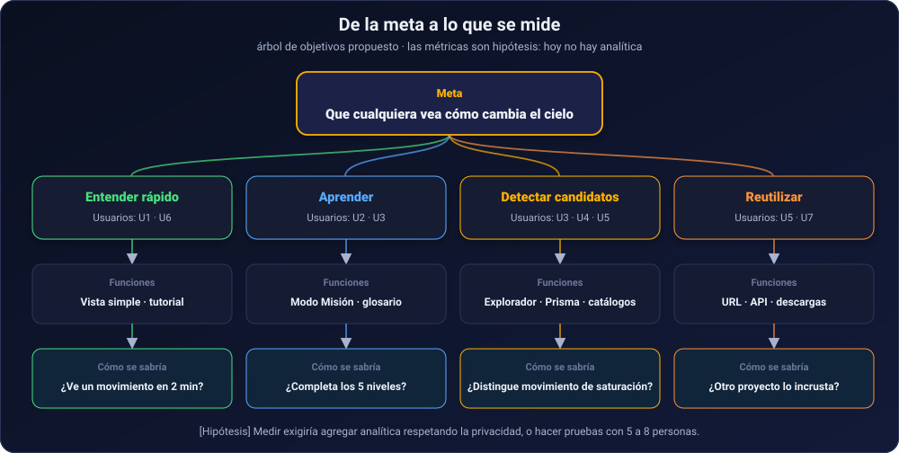
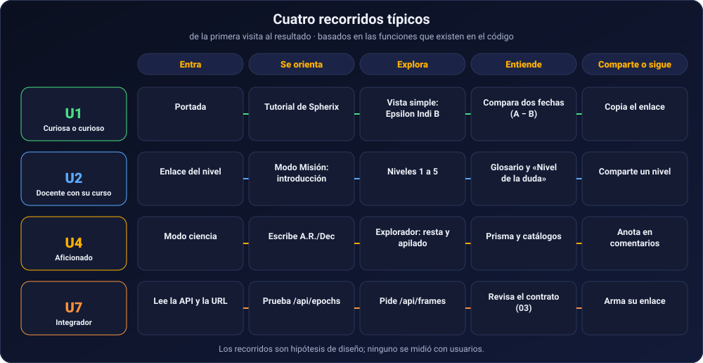

# 🎯 23 · Recorridos y objetivos

Este documento baja el análisis de usuarios ([21](21_TIPOS_DE_USUARIO.md)) y el mapa de funciones ([22](22_MAPA_DE_FUNCIONES.md)) a tres cosas prácticas: **qué se quiere lograr**, **por dónde pasa cada persona** y **cómo se sabría si funciona**.

> [!IMPORTANT]
> **Todo lo de aquí es una propuesta.** El equipo no definió objetivos medibles ni recoge analítica; las métricas llevan la etiqueta [Hipótesis] y no hay línea base. Los recorridos se basan en las funciones que existen en el código, no en observar a nadie. La sección final propone cómo validarlos.

## 🧭 Objetivo general

La meta que sale de la documentación del equipo, dicha en una línea:

> **Que cualquier persona vea cómo cambia el cielo con imágenes reales de SPHEREx, y quien quiera profundizar pueda hacerlo sin perderse.**

De ahí cuelgan cuatro objetivos, uno por nivel de uso, cada uno con los tipos de usuario que atiende.

## 📋 Objetivos por nivel

| # | Objetivo | Usuarios | Funciones que lo sirven | Señal de éxito [Hipótesis] | Riesgo conocido |
|---|---|---|---|---|---|
| **O1** | **Entender rápido** qué se ve y por qué importa | U1 U6 | Portada, vista simple, tutorial, «Compara dos fechas» | La persona ve un movimiento y lo explica en menos de 2 minutos | Movimiento de 1–2 píxeles; el visor no avisa cuando un objeto satura |
| **O2** | **Aprender** cómo se descubre algo comparando fotos | U2 U3 | Modo Misión, glosario, Spherix | Completa los 5 niveles y entiende la duda del nivel 4 | Sin guías para docentes; depende de datos de IRSA |
| **O3** | **Detectar candidatos** con herramientas confiables | U3 U4 U5 | Explorador, Prisma, catálogos, Apuntar | Distingue movimiento real de ruido o saturación | Espectro indicativo; sin flujo para reportar |
| **O4** | **Reutilizar y distribuir** la herramienta | U5 U7 | URL, API, descargas, instaladores | Otro proyecto la incrusta sin pedir ayuda | Contrato de la API con diferencias; instaladores sin firmar |

## 🛤️ Recorridos típicos

Cuatro recorridos, por las funciones que existen. Cada uno marca qué podría salir mal en cada paso.

### U1 · Curiosa o curioso: «¿qué es esto?»

| Etapa | Qué hace | Función | Qué podría fallar | Cómo mitigarlo hoy |
|---|---|---|---|---|
| Entra | Abre el enlace, desde el móvil | Portada | Carga lenta de la portada animada | PWA con *shell* cacheado |
| Se orienta | Toca «Empecemos con un tutorial» | Tutorial de la vista simple | Abandona antes de ver algo | Empieza y termina en Epsilon Indi B (datos precalculados) |
| Explora | Mira la imagen, mueve las fechas | Vista simple, barra «Luz» | La imagen no carga (IRSA a ratos) | «Reintentar», precalculado |
| Entiende | Compara dos fechas | «Compara dos fechas» (A − B) | No distingue un par rojo/azul real de uno falso | Textos de ayuda; **aviso de saturación pendiente** |
| Comparte o sigue | Copia el enlace o abre el Modo Misión | URL, Modo Misión | El enlace no guarda todo el estado | Documentado en [03](03_API.md) |

### U2 · Docente con su curso: «una clase sobre cómo se descubre Plutón»

| Etapa | Qué hace | Función | Qué podría fallar | Cómo mitigarlo hoy |
|---|---|---|---|---|
| Entra | Comparte el enlace del Modo Misión | `?mision=intro` | Las y los estudiantes llegan desde móviles distintos | PWA y navegador |
| Se orienta | Lee la introducción (1930, Tombaugh) | Modo Misión | Vocabulario difícil | Glosario con términos al pasar el mouse |
| Explora | Recorre los niveles 1 a 5 | Comparador, preguntas | Un nivel tarda en cargar | Datos precalculados de los objetos de prueba |
| Entiende | Discute el «nivel de la duda» (RW Aur) | Nivel 4 | Concepto de saturación | Texto del nivel; falta guía docente |
| Comparte o sigue | Pide a cada estudiante copiar el enlace de un nivel | «Copiar enlace de este nivel» | No hay registro de quién completó qué | **Sin seguimiento de curso** |

### U4 · Aficionado: «quiero ver si esto se mueve»

| Etapa | Qué hace | Función | Qué podría fallar | Cómo mitigarlo hoy |
|---|---|---|---|---|
| Entra | Activa «Modo ciencia» | Interruptor | No lo encuentra | Tutorial del Modo ciencia |
| Se orienta | Escribe A.R./Dec | `apuntar/coordenadas.ts` | Confunde horas y grados (factor 15) | Acepta sexagesimal y muestra la conversión |
| Explora | Resta y apila visitas | Explorador | Con 1 exposición por visita no se ve el movimiento débil | Preset de mediana de 10 |
| Entiende | Mira el espectro y los catálogos | Prisma, catálogos | Interpretar un espectro indicativo como calibrado | `caveat` y textos de límite |
| Comparte o sigue | Anota un comentario | Comentarios | Solo quedan en su navegador | **Sin exportar** |

### U7 · Integrador: «quiero abrir el visor desde mi sitio»

| Etapa | Qué hace | Función | Qué podría fallar | Cómo mitigarlo hoy |
|---|---|---|---|---|
| Entra | Lee el README | Documentación | No encuentra el contrato | [03 API](03_API.md) |
| Se orienta | Prueba `/api/epochs` | API | Parámetros que difieren del contrato | Lista de diferencias en [09](09_RIESGOS_Y_AUDITORIA.md) |
| Explora | Pide `/api/frames` | API | Tiempo de respuesta, `pending` | `budget_s`, respuesta parcial |
| Entiende | Revisa el contrato | `docs/03` | El contrato y el código divergen | Issues #72–#79 |
| Comparte o sigue | Arma enlaces con `?ra=&dec=&…` | URL | La URL no guarda estiramiento ni modo | Documentado |

## 📏 Qué medir, si se quisiera

> [!NOTE]
> Hoy **no hay forma de medir nada de esto**: el visor no recoge analítica, a propósito (sin cuentas ni datos personales). Medir exigiría una de dos cosas: pruebas con personas, o analítica mínima y anónima que se diseñe respetando la privacidad ([18](18_SEGURIDAD_Y_PRIVACIDAD.md)).

| Objetivo | Métrica propuesta [Hipótesis] | Cómo obtenerla sin analítica |
|---|---|---|
| O1 | Tiempo hasta que la persona **explica** un movimiento | Prueba con 5 a 8 personas, con cronómetro y preguntas |
| O1 | Porcentaje que llega a «Compara dos fechas» | Observación directa |
| O2 | Niveles completados del Modo Misión | Observación en una sesión de aula |
| O3 | ¿Distingue movimiento real de saturación? | Tarea con Barnard y RW Aur; respuesta correcta conocida |
| O4 | ¿Logra incrustar el visor con la documentación sola? | Prueba con una persona desarrolladora, sin ayuda |
| Todos | Errores de carga (503, timeouts) | Registros del backend, si se despliega con registro |

## 🧪 Cómo validar las hipótesis (propuesta)

1. **Elegir 5 a 8 personas por tipo** (más no es necesario para detectar los problemas grandes) y una tarea concreta por tipo: por ejemplo, para U1: «Mira esta estrella y cuéntame si se movió».
2. **Observar sin ayudar:** anotar dónde dudan, dónde se equivocan y qué dicen.
3. **Probar en el dispositivo real**, en especial el móvil y, si se mantiene, el iPhone.
4. **Resumir en una tabla** de hallazgos y cruzarla con los puntos de fricción de arriba.
5. **Corregir lo grande primero** (por ejemplo, el aviso de saturación) y repetir.
6. **Registrar lo aprendido** y actualizar [21](21_TIPOS_DE_USUARIO.md) y [22](22_MAPA_DE_FUNCIONES.md).

Ver también los [casos de uso con criterios de aceptación](24_CASOS_DE_USO.md) y la [hoja de ruta](17_HOJA_DE_RUTA.md).
