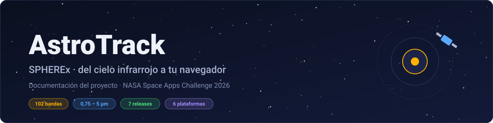

# 📚 Documentación

Estudio en profundidad del proyecto **AstroTrack · SPHEREx** (NASA Space Apps Challenge 2026), escrito sobre el repositorio oficial del equipo [mauriciovalenzuela742/SPHEREX](https://github.com/mauriciovalenzuela742/SPHEREX) en el commit `5b599b9` (2026-11-15). Este repositorio solo guarda las descargas y esta documentación; **no contiene código fuente**.

## 🧪 Cómo está hecho este estudio

Leí la documentación del repositorio oficial (`docs/`, `README.md`, `AGENTS.md`), su código (backend, frontend, apps nativas, CI) y los resultados del estudio de datos, y lo contrasté con lo que ejecuté: `pytest`, `ruff`, `tsc`, los instaladores del release y las páginas en línea. Es lectura; no se modificó el repositorio oficial. Donde algo es una inferencia mía y no un hecho comprobado, el texto lo dice.

## 🗂️ Índice

| # | Documento | Para quién | Qué responde |
|---|---|---|---|
| 🔭 01 | [El proyecto](01_PROYECTO.md) | Todas las personas | ¿Qué es AstroTrack y qué desafío resuelve? |
| 🏗️ 02 | [Arquitectura](02_ARQUITECTURA.md) | Desarrollo | ¿Cómo está armado y por qué así? |
| 🔗 03 | [La API](03_API.md) | Desarrollo | ¿Qué endpoints hay y cuáles no coinciden con el contrato? |
| 🛰️ 04 | [Datos de SPHEREx](04_DATOS_SPHEREX.md) | Desarrollo y ciencia | ¿De dónde salen los datos y qué trampas tienen? |
| ⚙️ 05 | [Backend](05_BACKEND.md) | Desarrollo | ¿Qué hace cada módulo y cómo se prueba? |
| 🖥️ 06 | [Visor (frontend)](06_FRONTEND.md) | Desarrollo | ¿Qué hay en cada carpeta y cómo se corre? |
| 📦 07 | [Apps instalables y releases](07_APPS_NATIVAS_Y_RELEASES.md) | Desarrollo y entrega | ¿Cómo se construye y publica un release? |
| 🔬 08 | [Hallazgos científicos](08_HALLAZGOS_CIENTIFICOS.md) | Ciencia | ¿Qué dicen los datos reales? |
| 🛡️ 09 | [Riesgos y auditoría](09_RIESGOS_Y_AUDITORIA.md) | Coordinación | ¿Qué está roto o por confirmar? |
| 🤖 10 | [Herramientas y uso de IA](10_HERRAMIENTAS_Y_IA.md) | Todas las personas | ¿Cómo se usó la IA y qué reglas siguió el equipo? |
| 📖 11 | [Glosario](11_GLOSARIO.md) | Todas las personas | ¿Qué significa «época», «LVF», «HiPS»…? |
| ✅ 12 | [Instalar y verificar](12_VERIFICAR_DESCARGAS.md) | Usuarios | ¿Cómo instalo y compruebo una descarga? |
| 🕰️ 13 | [Cronología](13_CRONOLOGIA.md) | Todas las personas | ¿Qué trajo cada versión? |
| ❓ 14 | [Preguntas y respuestas](14_PREGUNTAS_FRECUENTES.md) | Todas las personas | Las dudas más probables, con respuesta corta y enlace |
| 💼 15 | [Alcance y potencial comercial](15_ALCANCE_COMERCIAL.md) | Coordinación y evaluación | ¿A quién sirve, qué cuesta y qué falta para un uso serio? |
| ⚖️ 16 | [Comparativa y estado del arte](16_COMPARATIVA_Y_ESTADO_DEL_ARTE.md) | Evaluación y ciencia | ¿Qué existe ya y dónde está el hueco? |
| 🛣️ 17 | [Hoja de ruta](17_HOJA_DE_RUTA.md) | Coordinación | ¿Qué conviene hacer, y en qué orden? |
| 🔐 18 | [Seguridad y privacidad](18_SEGURIDAD_Y_PRIVACIDAD.md) | Desarrollo y usuarios | ¿Qué datos maneja y qué riesgos hay? |
| 🎤 19 | [El pitch y la entrega](19_PITCH_Y_ENTREGA.md) | Evaluación y equipos futuros | ¿Cómo se presentó y se entregó? |
| 🧬 20 | [Originalidad y diferenciadores](20_ORIGINALIDAD_Y_DIFERENCIADORES.md) | Evaluación y equipos futuros | ¿Y si otro equipo hizo lo mismo? ¿Qué es propio? |

## 🧭 Rutas de lectura

- **Quiero instalar la app:** [12](12_VERIFICAR_DESCARGAS.md) y la [página de descargas](https://vladimiracunadev-create.github.io/spherex-releases/).
- **Quiero entender el proyecto en 10 minutos:** [01](01_PROYECTO.md), [02](02_ARQUITECTURA.md) y [11](11_GLOSARIO.md).
- **Voy a tocar el código:** [03](03_API.md), [05](05_BACKEND.md), [06](06_FRONTEND.md) y [09](09_RIESGOS_Y_AUDITORIA.md).
- **Voy a publicar un release:** [07](07_APPS_NATIVAS_Y_RELEASES.md) y [13](13_CRONOLOGIA.md).
- **Me interesa la ciencia:** [04](04_DATOS_SPHEREX.md) y [08](08_HALLAZGOS_CIENTIFICOS.md).
- **Evalúo el proyecto (jurado, institución, posible uso comercial):** [01](01_PROYECTO.md), [14](14_PREGUNTAS_FRECUENTES.md), [15](15_ALCANCE_COMERCIAL.md), [16](16_COMPARATIVA_Y_ESTADO_DEL_ARTE.md) y [19](19_PITCH_Y_ENTREGA.md).
- **Me preocupa la seguridad o la privacidad:** [18](18_SEGURIDAD_Y_PRIVACIDAD.md) y [SECURITY.md](../SECURITY.md).
- **Me preguntan si es original o si otro equipo hizo lo mismo:** [20](20_ORIGINALIDAD_Y_DIFERENCIADORES.md), [16](16_COMPARATIVA_Y_ESTADO_DEL_ARTE.md) y [19](19_PITCH_Y_ENTREGA.md).
- **Quiero saber qué sigue:** [17](17_HOJA_DE_RUTA.md) y [09](09_RIESGOS_Y_AUDITORIA.md).

## 🔗 Enlaces útiles

- Aplicación en línea: <https://spherex-planet-x-tau.vercel.app/>
- Repositorio oficial: <https://github.com/mauriciovalenzuela742/SPHEREX>
- Desafío: <https://www.spaceappschallenge.org/2026/challenges/planet-x-and-spherex/>
- Datos: <https://irsa.ipac.caltech.edu/Missions/spherex.html> · tutoriales: <https://caltech-ipac.github.io/irsa-tutorials/spherex/>

## ⏳ Vigencia

Esta documentación es una **fotografía del 2026-11-15**. El repositorio oficial sigue cambiando; las cifras (líneas de código, número de pruebas, versión desplegada del backend) pueden haber cambiado. Ante una diferencia, manda el repositorio oficial.
